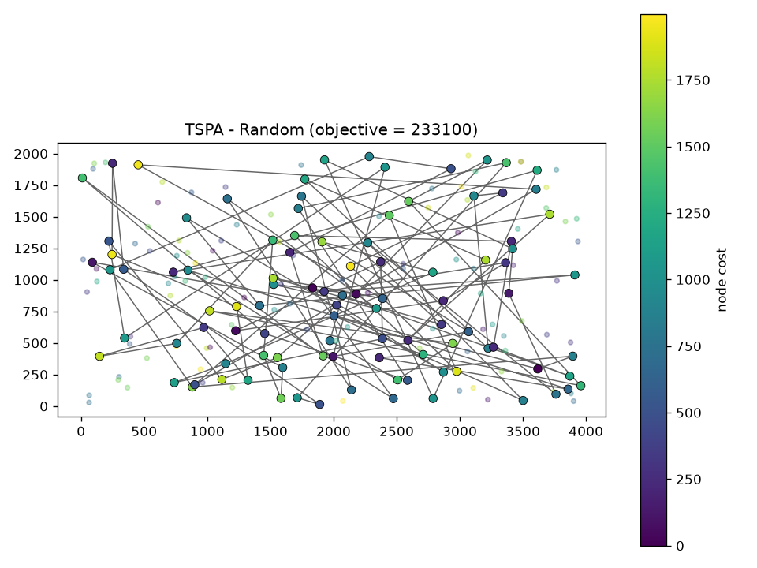
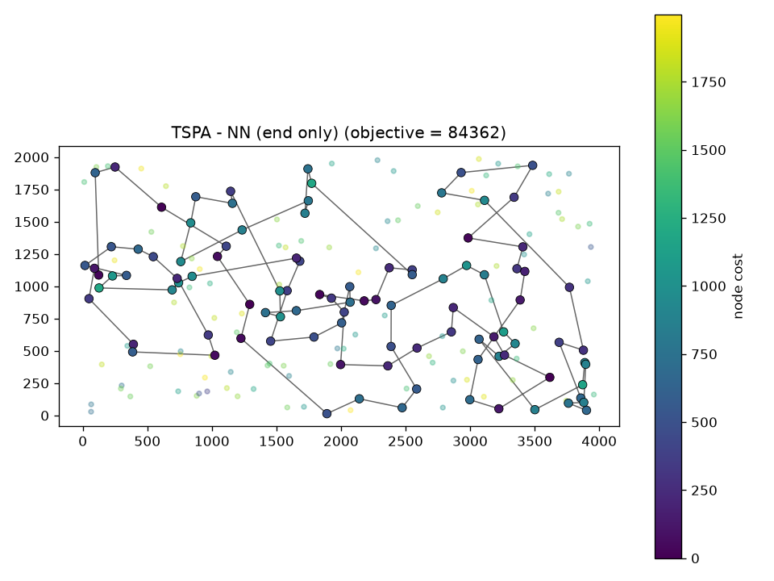
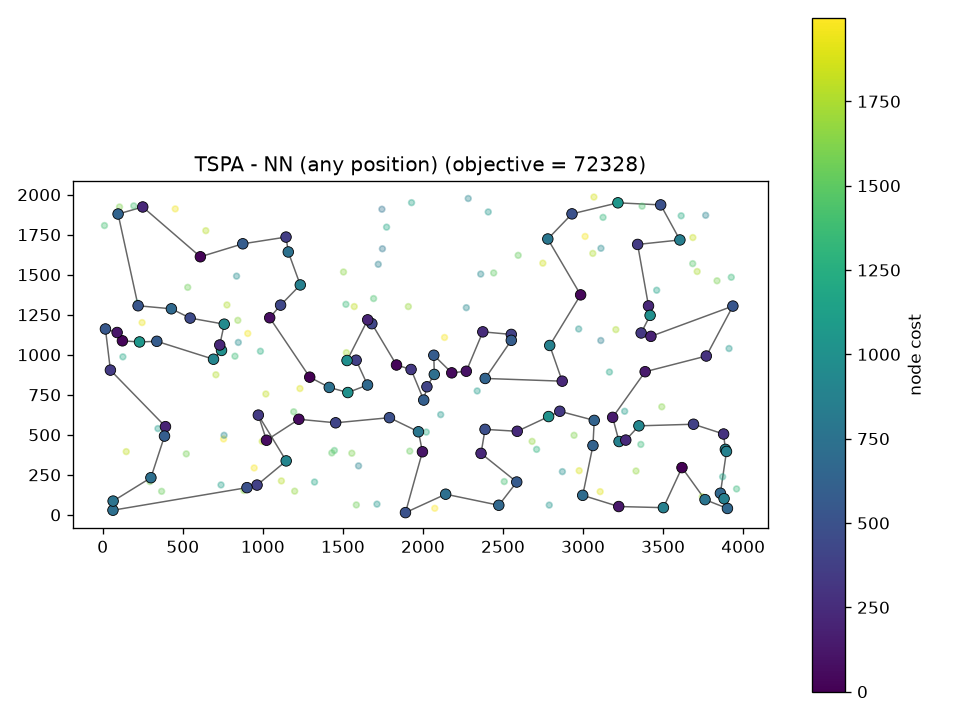
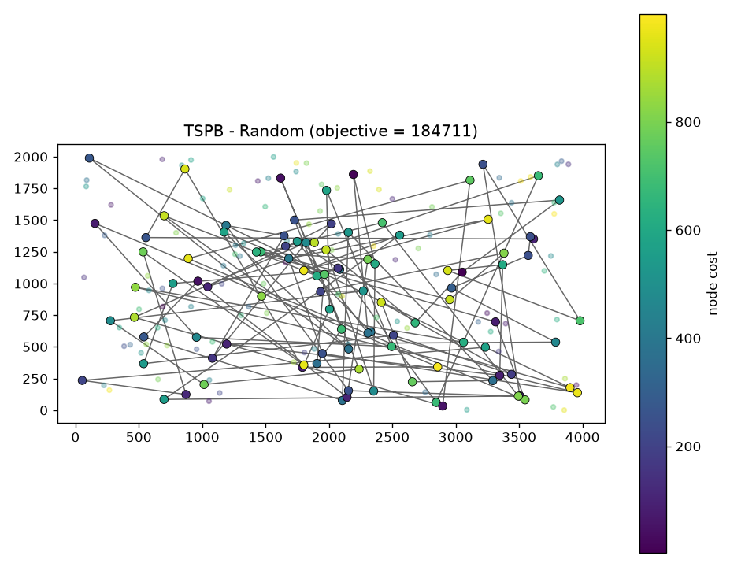
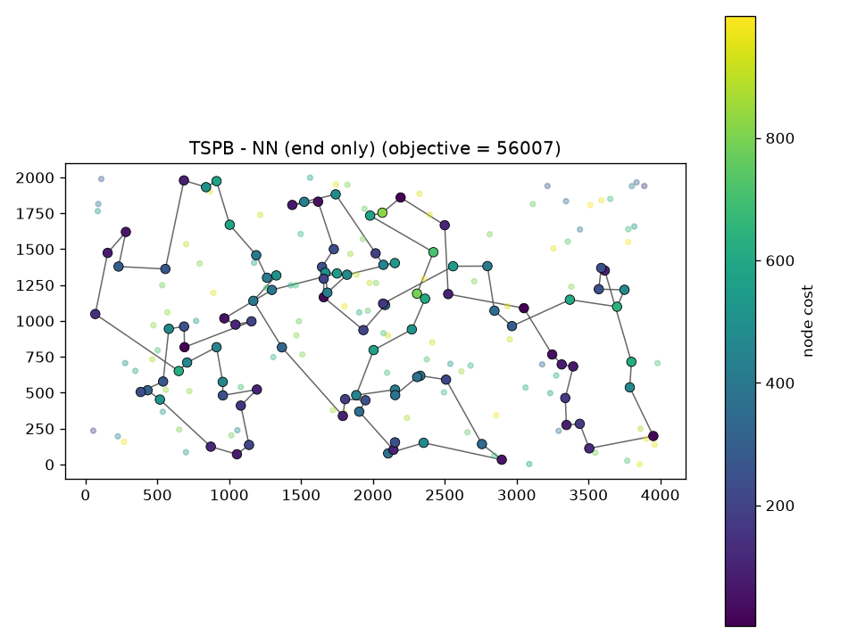
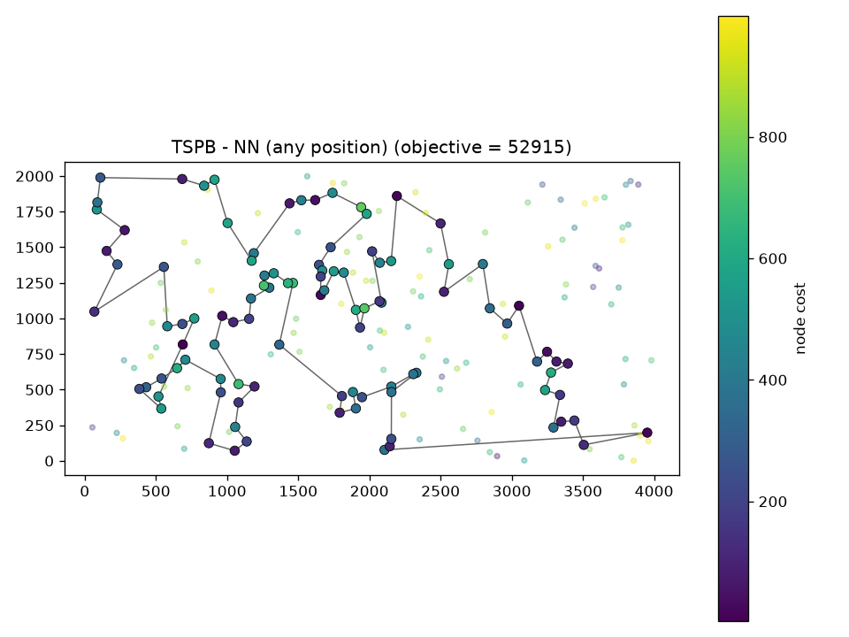
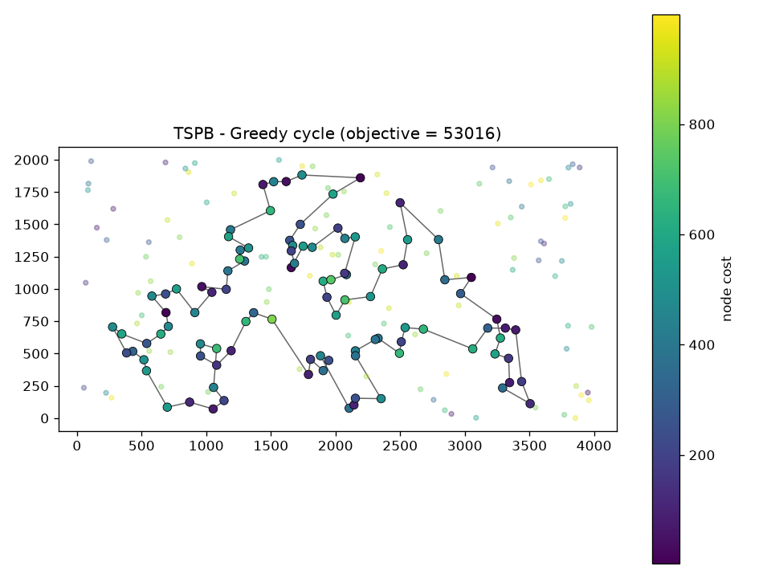

# Evolutionary Computation - Assignment 1 (greedy heuristics)

Authors:
1. Name: Tomasz Preś  Index number: 160305
2. Name: Marek Olejniczak  Index number: 160303

## Problem

We are given three columns of integers with a row for each node. The first two columns contain x
and y coordinates of the node positions in a plane. The third column contains node costs. The goal is
to select exactly 50% of the nodes (if the number of nodes is odd we round the number of nodes to
be selected up) and form a Hamiltonian cycle (closed path) through this set of nodes such that the
sum of the total length of the path plus the total cost of the selected nodes is minimized.

The distances between nodes are calculated as Euclidean distances rounded mathematically to
integer values. The distance matrix should be calculated just after reading an instance and then only
the distance matrix (no nodes coordinates) should be accessed by optimization methods to allow
instances defined only by distance matrices.

In all greedy methods "nearest" means the node that increases the objective the least
(distance + node cost), not just the closest one.

## Algorithms (pseudocode)

Random:
```
pick 100 random nodes in random order
```

NN, adding only at the end:
```
path = [start]
while len(path) < 100:
    pick unvisited v with smallest d(last, v) + cost(v)
    add v at the end
close the cycle (last -> first)
```

NN, adding at any position:
```
path = [start]
while len(path) < 100:
    for each unvisited v check every position:
        at the beginning:  d(v, first) + cost(v)
        at the end:        d(last, v) + cost(v)
        between a and b:   d(a, v) + d(v, b) - d(a, b) + cost(v)
    insert the best v at the best position
close the cycle
```

Greedy cycle:
```
cycle = [start, node with smallest d(start, v) + cost(v)]
while len(cycle) < 100:
    for each unvisited v and each edge (a, b) in cycle:
        d(a, v) + d(v, b) - d(a, b) + cost(v)
    insert the best v into the best edge
```

Every greedy method was run 200 times (from every node as start), random was run 200 times too.

## Results

| Instance | Method | Min | Max | Avg |
|---|---|---|---|---|
| TSPA | Random | 233100 | 297465 | 261993.9 |
| TSPA | NN (end only) | 84362 | 90075 | 87476.6 |
| TSPA | NN (any position) | 72328 | 77022 | 74306.5 |
| TSPA | Greedy cycle | 72590 | 75281 | 73728.7 |
| TSPB | Random | 184711 | 232627 | 206845.1 |
| TSPB | NN (end only) | 56007 | 63166 | 59397.3 |
| TSPB | NN (any position) | 52915 | 66164 | 59476.2 |
| TSPB | Greedy cycle | 53016 | 63736 | 59710.4 |

## Best solutions

Color of a node = its cost (bigger, outlined dots are the selected nodes).

### TSPA, Random

objective = 233100



nodes: [3, 174, 141, 33, 84, 92, 189, 194, 190, 150, 135, 154, 95, 60, 166, 70, 53, 149, 98, 22, 27, 196, 161, 188, 30, 10, 191, 167, 48, 49, 114, 25, 19, 139, 158, 87, 77, 121, 51, 136, 39, 11, 32, 170, 107, 140, 64, 143, 88, 93, 169, 175, 111, 17, 123, 155, 134, 128, 5, 42, 184, 178, 74, 165, 15, 171, 101, 126, 131, 172, 176, 112, 181, 71, 99, 156, 177, 163, 34, 26, 23, 0, 20, 73, 179, 75, 89, 1, 133, 65, 58, 153, 90, 192, 67, 138, 38, 28, 37, 144]

### TSPA, NN (end only)

objective = 84362



nodes: [54, 9, 33, 36, 177, 67, 144, 53, 135, 58, 134, 176, 174, 106, 89, 107, 57, 182, 151, 93, 50, 3, 1, 164, 178, 29, 136, 186, 184, 47, 159, 130, 153, 78, 88, 193, 170, 146, 75, 64, 150, 42, 113, 43, 85, 142, 8, 131, 84, 158, 192, 181, 114, 141, 180, 132, 76, 80, 48, 31, 63, 149, 168, 97, 127, 187, 30, 123, 152, 108, 60, 116, 49, 11, 119, 160, 83, 90, 51, 16, 35, 87, 45, 140, 52, 179, 185, 28, 102, 156, 157, 71, 91, 38, 100, 4, 112, 139, 115, 5]

### TSPA, NN (any position)

objective = 72328



nodes: [104, 129, 69, 127, 97, 168, 116, 149, 63, 11, 49, 160, 83, 123, 100, 152, 108, 60, 31, 48, 80, 91, 157, 71, 4, 76, 132, 180, 28, 102, 185, 35, 156, 51, 16, 67, 144, 140, 53, 179, 52, 177, 36, 33, 9, 54, 131, 174, 8, 164, 186, 136, 163, 29, 101, 178, 1, 169, 3, 50, 147, 47, 93, 106, 42, 89, 113, 130, 159, 146, 170, 153, 193, 78, 88, 107, 64, 57, 182, 151, 150, 176, 72, 134, 84, 58, 158, 192, 181, 114, 135, 73, 45, 87, 141, 187, 30, 189, 2, 171]

### TSPA, Greedy cycle

objective = 72590


nodes: [31, 116, 149, 168, 63, 11, 49, 60, 108, 152, 100, 90, 123, 83, 160, 97, 127, 69, 171, 2, 189, 30, 187, 141, 87, 45, 73, 135, 114, 181, 192, 158, 58, 84, 134, 72, 176, 150, 151, 182, 57, 64, 107, 88, 78, 193, 153, 170, 146, 159, 130, 113, 89, 42, 106, 93, 47, 147, 50, 3, 169, 1, 178, 101, 29, 163, 136, 186, 164, 142, 8, 174, 131, 54, 9, 33, 36, 177, 52, 179, 53, 140, 144, 67, 16, 51, 156, 35, 185, 102, 28, 180, 132, 76, 4, 71, 157, 91, 80, 48]

### TSPB, Random

objective = 184711



nodes: [128, 12, 160, 167, 112, 53, 150, 37, 4, 184, 8, 34, 89, 135, 88, 109, 84, 54, 61, 120, 122, 123, 181, 191, 173, 51, 25, 96, 126, 142, 178, 27, 151, 41, 106, 168, 95, 72, 140, 169, 39, 3, 26, 36, 67, 14, 35, 163, 74, 86, 82, 6, 154, 87, 75, 189, 129, 9, 161, 194, 171, 102, 117, 60, 133, 130, 179, 188, 79, 172, 24, 100, 182, 1, 175, 138, 101, 98, 156, 31, 155, 28, 186, 85, 7, 158, 114, 196, 10, 192, 118, 40, 20, 78, 159, 131, 190, 2, 62, 185]

### TSPB, NN (end only)

objective = 56007



nodes: [32, 89, 57, 76, 54, 127, 129, 90, 153, 20, 14, 2, 110, 118, 56, 114, 196, 10, 148, 143, 78, 192, 162, 104, 185, 184, 3, 151, 69, 172, 133, 120, 96, 121, 198, 48, 72, 46, 86, 117, 160, 136, 8, 21, 154, 140, 47, 170, 125, 177, 6, 132, 29, 197, 175, 134, 45, 60, 40, 71, 155, 97, 115, 180, 65, 28, 149, 145, 158, 116, 147, 42, 50, 130, 30, 183, 38, 64, 85, 59, 167, 51, 87, 179, 82, 88, 171, 99, 67, 24, 34, 181, 152, 73, 98, 27, 135, 75, 79, 156]

### TSPB, NN (any position)

objective = 52915



nodes: [110, 2, 14, 20, 74, 153, 182, 52, 90, 129, 127, 80, 54, 192, 162, 104, 76, 185, 57, 89, 86, 46, 72, 3, 184, 173, 151, 122, 117, 8, 160, 69, 172, 136, 133, 120, 156, 43, 48, 96, 198, 121, 130, 191, 50, 42, 147, 116, 37, 146, 13, 149, 28, 145, 65, 158, 177, 125, 26, 170, 197, 36, 132, 29, 6, 180, 115, 155, 71, 175, 134, 45, 157, 60, 40, 141, 97, 154, 140, 47, 38, 21, 176, 30, 183, 189, 168, 64, 59, 85, 51, 73, 167, 152, 34, 24, 181, 179, 87, 82]

### TSPB, Greedy cycle

objective = 53016



nodes: [49, 64, 33, 40, 60, 71, 155, 141, 157, 45, 134, 175, 62, 36, 197, 29, 132, 178, 103, 6, 180, 115, 170, 177, 125, 26, 97, 140, 154, 47, 38, 21, 176, 30, 183, 191, 130, 63, 121, 198, 96, 48, 89, 156, 120, 133, 136, 172, 160, 69, 8, 117, 72, 46, 86, 184, 3, 173, 122, 151, 98, 111, 27, 135, 76, 185, 57, 104, 162, 54, 192, 127, 52, 182, 153, 20, 74, 2, 14, 90, 129, 80, 150, 84, 66, 67, 31, 24, 34, 152, 181, 88, 179, 87, 82, 73, 167, 51, 59, 85]

## Checker

Yes, the best solutions were checked with the solution checker, values are the same.

## Code

greedy.py (python, numpy + matplotlib). Link: https://github.com/tomasz-pres/evolutionary-computing.git

## Conclusions

- all greedy methods are way better than random (about 3.5x)
- adding nodes anywhere in the path (NN any position, greedy cycle) is better than adding only at the end,
  on TSPA it is about 74k vs 87k on average. On TSPB averages are similar but the best results are better (53k vs 56k)
- greedy cycle was the most stable on TSPA (lowest max and avg)
- NN any position does not care about the last edge back to the start, so sometimes it is long
- start node matters a lot, results differ by a few thousand
- on the plots you can see that the algorithms mostly pick cheap nodes
