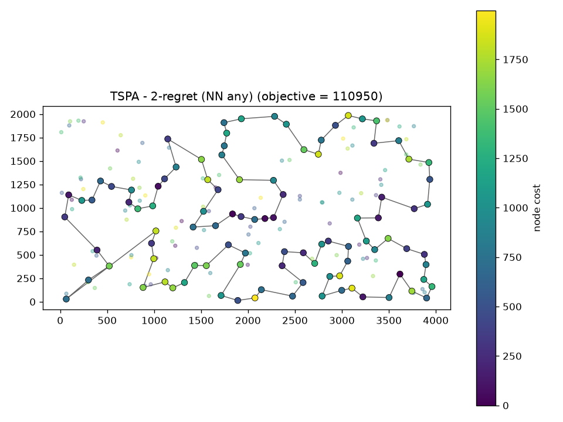
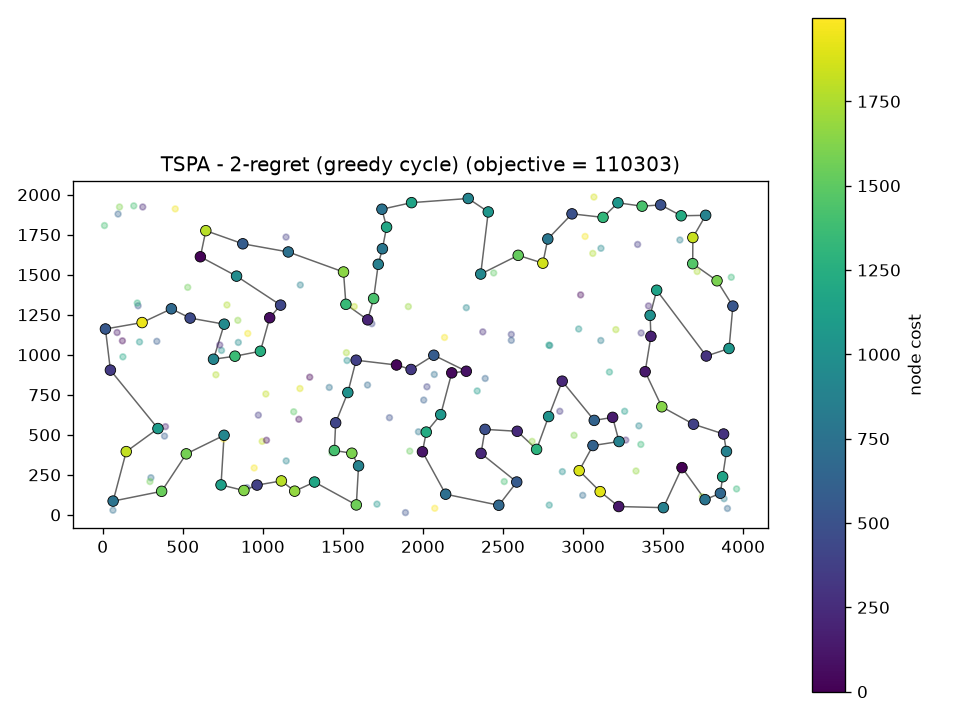
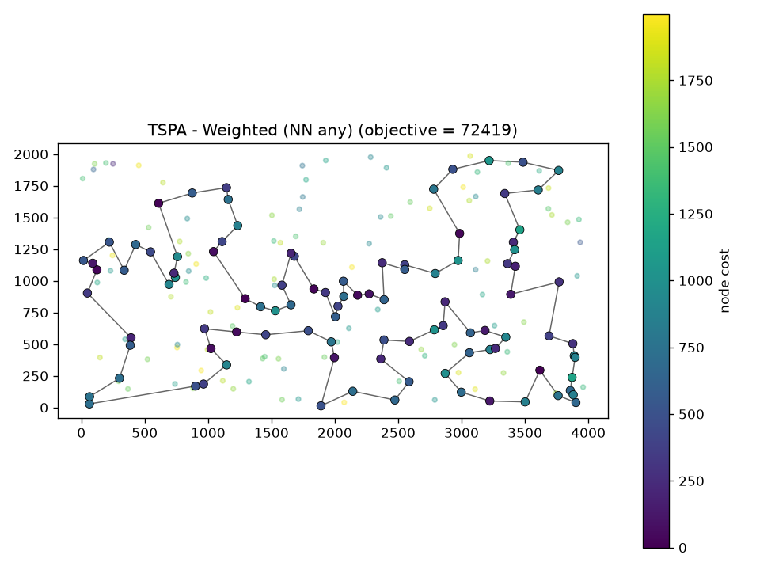
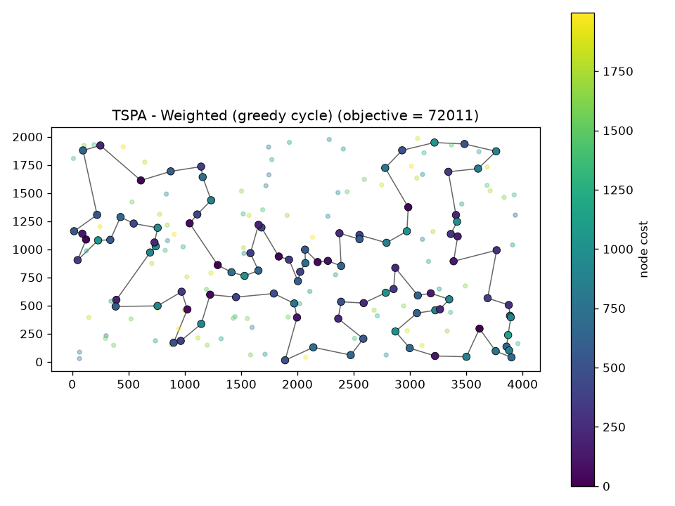
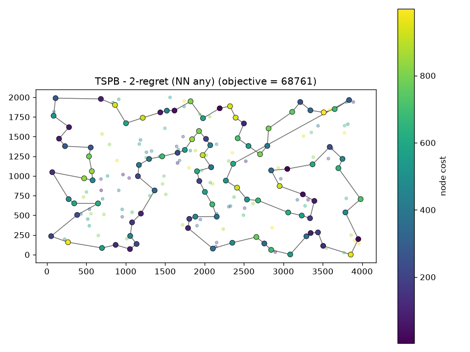
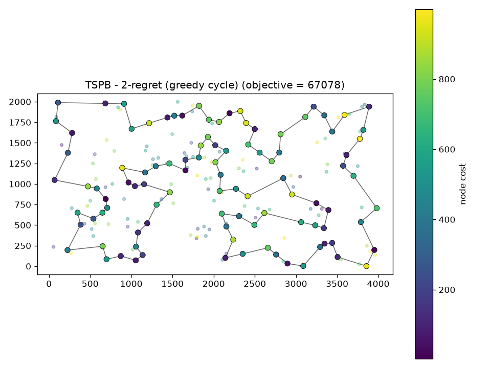
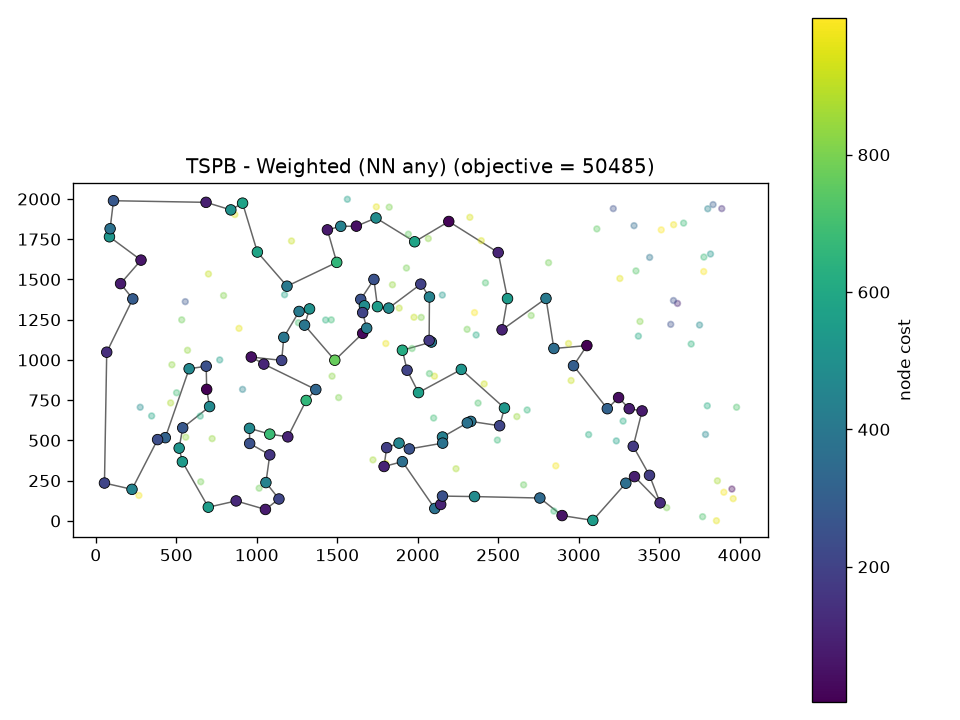
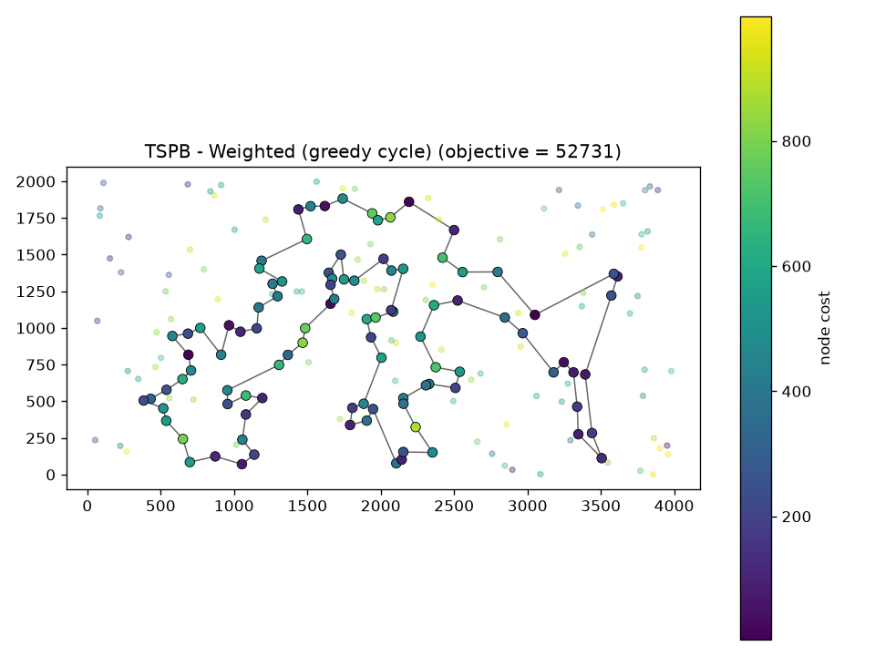

# Evolutionary Computation - Assignment 2 (greedy regret heuristics)

Authors:
1. Name: Tomasz Preś  Index number: 160305
2. Name: Marek Olejniczak  Index number: 160303

## Problem

We are given three columns of integers with a row for each node. The first two columns contain x
and y coordinates of the node positions in a plane. The third column contains node costs. The goal is
to select exactly 50% of the nodes (if the number of nodes is odd we round the number of nodes to
be selected up) and form a Hamiltonian cycle (closed path) through this set of nodes such that the
sum of the total length of the path plus the total cost of the selected nodes is minimized.

The distances between nodes are calculated as Euclidean distances rounded mathematically to
integer values. The distance matrix should be calculated just after reading an instance and then only
the distance matrix (no nodes coordinates) should be accessed by optimization methods to allow
instances defined only by distance matrices.

In all greedy methods "nearest" means the node that increases the objective the least
(distance + node cost), not just the closest one.

## Algorithms (pseudocode)

Both new methods are built on top of NN with any position (path) and greedy cycle from assignment 1.
The only thing that changes is how we pick the next node.

Insertion cost of node v at some position (same as before):
```
between a and b:        d(a, v) + d(v, b) - d(a, b) + cost(v)
(NN any only) at start: d(v, first) + cost(v)
(NN any only) at end:   d(last, v) + cost(v)
```

Greedy 2-regret:
```
start like before (NN any: [start], greedy cycle: [start, best neighbour])
while len(solution) < 100:
    for each unvisited v:
        best1 = cheapest insertion cost of v
        best2 = 2nd cheapest insertion cost of v
        regret(v) = best2 - best1
    pick v with the biggest regret (if tie: smaller best1)
    insert v at its cheapest position
```

Weighted sum (2-regret + best change):
```
same as above, but pick v with the biggest
    score(v) = w_regret * regret(v) - w_best * best1(v)
default w_regret = w_best = 1
```

Every method was run 200 times (from every node as start).

## Results

All methods (previous ones included):

| Instance | Method | Min | Max | Avg |
|---|---|---|---|---|
| TSPA | Random | 233100 | 297465 | 261993.9 |
| TSPA | NN (end only) | 84362 | 90075 | 87476.6 |
| TSPA | NN (any position) | 72328 | 77022 | 74306.5 |
| TSPA | Greedy cycle | 72590 | 75281 | 73728.7 |
| TSPA | 2-regret (NN any) | 110950 | 135771 | 121360.3 |
| TSPA | 2-regret (greedy cycle) | 110303 | 128089 | 120367.5 |
| TSPA | Weighted (NN any) | 72419 | 78504 | 75549.4 |
| TSPA | Weighted (greedy cycle) | 72011 | 75532 | 73348.7 |
| TSPB | Random | 184711 | 232627 | 206845.1 |
| TSPB | NN (end only) | 56007 | 63166 | 59397.3 |
| TSPB | NN (any position) | 52915 | 66164 | 59476.2 |
| TSPB | Greedy cycle | 53016 | 63736 | 59710.4 |
| TSPB | 2-regret (NN any) | 68761 | 79756 | 73649.8 |
| TSPB | 2-regret (greedy cycle) | 67078 | 76382 | 72368.0 |
| TSPB | Weighted (NN any) | 50485 | 61406 | 55698.9 |
| TSPB | Weighted (greedy cycle) | 52731 | 63370 | 57892.5 |

Weighted sum with different weights:

| Instance | Variant | w_regret | w_best | Min | Max | Avg |
|---|---|---|---|---|---|---|
| TSPA | NN any | 1 | 1 | 72419 | 78504 | 75549.4 |
| TSPA | NN any | 2 | 1 | 73614 | 79873 | 76408.1 |
| TSPA | NN any | 1 | 2 | 72134 | 78210 | 75279.7 |
| TSPA | NN any | 1 | 4 | 72758 | 77251 | 74982.3 |
| TSPA | greedy cycle | 1 | 1 | 72011 | 75532 | 73348.7 |
| TSPA | greedy cycle | 2 | 1 | 72575 | 76095 | 74283.9 |
| TSPA | greedy cycle | 1 | 2 | 72049 | 75212 | 73191.4 |
| TSPA | greedy cycle | 1 | 4 | 72430 | 75847 | 73836.5 |
| TSPB | NN any | 1 | 1 | 50485 | 61406 | 55698.9 |
| TSPB | NN any | 2 | 1 | 51286 | 60794 | 54710.1 |
| TSPB | NN any | 1 | 2 | 52302 | 63489 | 56150.8 |
| TSPB | NN any | 1 | 4 | 52203 | 66396 | 57085.5 |
| TSPB | greedy cycle | 1 | 1 | 52731 | 63370 | 57892.5 |
| TSPB | greedy cycle | 2 | 1 | 52780 | 63809 | 59617.0 |
| TSPB | greedy cycle | 1 | 2 | 52099 | 62556 | 55667.6 |
| TSPB | greedy cycle | 1 | 4 | 52877 | 62382 | 56337.5 |

## Best solutions

Color of a node = its cost (bigger, outlined dots are the selected nodes).

### TSPA, 2-regret (NN any)

objective = 110950



nodes: [104, 69, 120, 97, 168, 149, 11, 49, 108, 152, 100, 123, 148, 162, 132, 76, 4, 157, 18, 173, 16, 156, 28, 185, 67, 144, 179, 177, 36, 33, 143, 190, 139, 112, 5, 115, 175, 39, 154, 34, 109, 186, 136, 197, 163, 19, 178, 101, 155, 21, 147, 37, 47, 50, 93, 81, 43, 113, 117, 130, 159, 170, 75, 26, 78, 122, 107, 64, 57, 105, 182, 111, 138, 165, 151, 150, 176, 72, 65, 134, 84, 58, 158, 192, 181, 118, 114, 25, 121, 73, 45, 70, 96, 10, 183, 166, 32, 40, 30, 23]

### TSPA, 2-regret (greedy cycle)

objective = 110303



nodes: [135, 181, 192, 158, 58, 84, 134, 65, 72, 174, 150, 106, 42, 151, 165, 105, 57, 64, 107, 88, 153, 75, 170, 159, 130, 117, 93, 50, 169, 59, 47, 37, 147, 6, 46, 86, 55, 17, 29, 19, 163, 24, 136, 186, 109, 34, 62, 154, 39, 175, 115, 5, 112, 139, 133, 51, 196, 18, 71, 91, 137, 80, 38, 76, 132, 162, 148, 160, 100, 152, 108, 167, 116, 168, 95, 188, 129, 110, 120, 161, 92, 32, 2, 166, 183, 10, 22, 98, 70, 27, 87, 102, 35, 67, 144, 52, 36, 177, 41, 61]

### TSPA, Weighted (NN any)

objective = 72419



nodes: [171, 2, 189, 187, 30, 141, 87, 45, 73, 135, 114, 181, 192, 158, 58, 84, 134, 72, 176, 174, 150, 106, 113, 89, 42, 151, 138, 182, 57, 64, 107, 88, 78, 193, 153, 75, 170, 146, 159, 130, 47, 93, 50, 3, 169, 1, 59, 178, 101, 55, 29, 163, 136, 186, 164, 142, 8, 9, 54, 33, 131, 36, 177, 52, 179, 53, 140, 144, 67, 16, 51, 35, 185, 102, 28, 180, 132, 76, 4, 71, 157, 91, 80, 100, 123, 83, 160, 152, 108, 49, 60, 116, 149, 63, 168, 97, 127, 69, 129, 104]

### TSPA, Weighted (greedy cycle)

objective = 72011



nodes: [31, 60, 116, 149, 63, 168, 11, 49, 108, 152, 100, 123, 83, 160, 97, 127, 161, 30, 187, 171, 2, 189, 141, 87, 45, 73, 135, 114, 181, 192, 158, 58, 84, 134, 72, 176, 174, 150, 106, 113, 89, 42, 151, 138, 182, 57, 64, 107, 88, 78, 193, 153, 75, 170, 146, 159, 130, 47, 93, 50, 3, 169, 1, 178, 101, 55, 29, 163, 136, 186, 164, 142, 8, 9, 54, 33, 131, 36, 177, 52, 179, 53, 140, 144, 67, 16, 51, 35, 185, 102, 28, 180, 132, 76, 4, 71, 157, 91, 80, 48]

### TSPB, 2-regret (NN any)

objective = 68761



nodes: [94, 169, 199, 70, 190, 194, 77, 104, 144, 185, 79, 57, 83, 44, 89, 156, 164, 96, 198, 121, 195, 50, 7, 116, 37, 13, 149, 28, 145, 158, 138, 55, 177, 53, 65, 178, 103, 180, 132, 1, 108, 62, 175, 134, 45, 157, 60, 40, 64, 47, 38, 21, 168, 172, 8, 92, 166, 72, 46, 109, 3, 122, 151, 98, 25, 181, 73, 59, 85, 82, 88, 163, 99, 39, 17, 74, 20, 14, 2, 23, 110, 118, 131, 143, 148, 196, 78, 54, 162, 106, 127, 90, 153, 182, 150, 84, 66, 35, 27, 135]

### TSPB, 2-regret (greedy cycle)

objective = 67078



nodes: [21, 38, 161, 154, 140, 47, 4, 33, 40, 60, 157, 45, 134, 175, 62, 91, 174, 132, 103, 6, 180, 115, 170, 177, 53, 65, 145, 149, 13, 37, 116, 42, 50, 195, 121, 198, 96, 164, 43, 32, 89, 44, 83, 57, 79, 185, 144, 104, 77, 194, 190, 70, 187, 165, 105, 61, 193, 114, 10, 143, 131, 118, 110, 23, 2, 14, 20, 74, 17, 171, 99, 163, 88, 87, 126, 181, 25, 34, 31, 119, 150, 182, 153, 90, 127, 106, 162, 35, 27, 111, 3, 137, 86, 72, 166, 92, 117, 172, 69, 168]

### TSPB, Weighted (NN any)

objective = 50485



nodes: [65, 145, 28, 149, 13, 146, 37, 116, 147, 42, 50, 130, 63, 121, 198, 96, 48, 156, 89, 57, 185, 76, 104, 162, 54, 192, 80, 127, 129, 90, 153, 14, 2, 20, 74, 17, 171, 99, 88, 179, 87, 82, 51, 85, 59, 73, 167, 181, 152, 34, 24, 67, 66, 27, 98, 151, 122, 3, 184, 46, 72, 117, 8, 120, 133, 136, 172, 160, 69, 124, 21, 183, 30, 38, 47, 154, 140, 64, 33, 40, 141, 155, 71, 60, 157, 45, 134, 175, 62, 36, 197, 6, 115, 170, 125, 177, 29, 132, 174, 1]

### TSPB, Weighted (greedy cycle)

objective = 52731



nodes: [91, 36, 197, 132, 29, 6, 180, 115, 170, 177, 125, 26, 97, 154, 140, 47, 38, 21, 30, 183, 191, 130, 63, 121, 198, 96, 48, 43, 156, 32, 89, 57, 79, 185, 104, 54, 196, 114, 10, 90, 14, 2, 20, 153, 129, 127, 80, 192, 162, 76, 135, 27, 11, 66, 67, 24, 34, 152, 181, 126, 88, 179, 87, 82, 167, 51, 85, 59, 73, 98, 151, 122, 173, 3, 184, 86, 46, 72, 117, 8, 120, 133, 136, 172, 160, 69, 124, 4, 64, 33, 155, 71, 141, 40, 60, 157, 45, 134, 175, 62]

## Checker

Yes, the best solutions were checked with the solution checker, values are the same.

## Code

regret.py (python, numpy + matplotlib), uses greedy.py from lab1. Link: https://github.com/tomasz-pres/evolutionary-computing.git

## Conclusions

- pure 2-regret is bad, much worse than normal greedy (TSPA ~120k vs ~74k, TSPB ~73k vs ~59k). The reason is
  that cost(v) is in both best1 and best2 so it cancels out in the regret, so the algorithm does not care
  about node costs at all and picks a lot of expensive nodes (you can see many yellow nodes on the plots)
- weighted sum fixes this because it also looks at the best change, and it is the best method so far:
  TSPA greedy cycle avg 73349 (was 73729), TSPB NN any avg 55699 (was 59476), best TSPB = 50485
- for the weighted version the greedy cycle is better on TSPA and NN any is better on TSPB
- different weights: on TSPA 1:2 was a bit better than 1:1 for both variants,
  on TSPB it depends on the variant (NN any best with 2:1, greedy cycle best with 1:2),
  differences are not big (up to ~4% of the average), equal weights are an ok default
