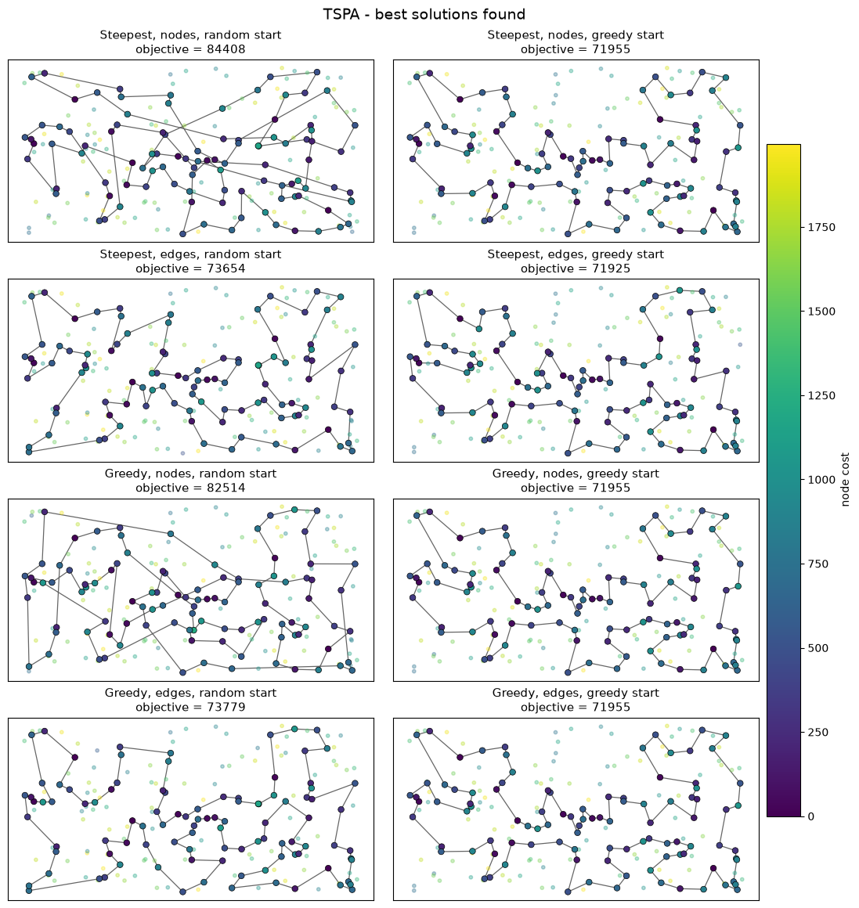
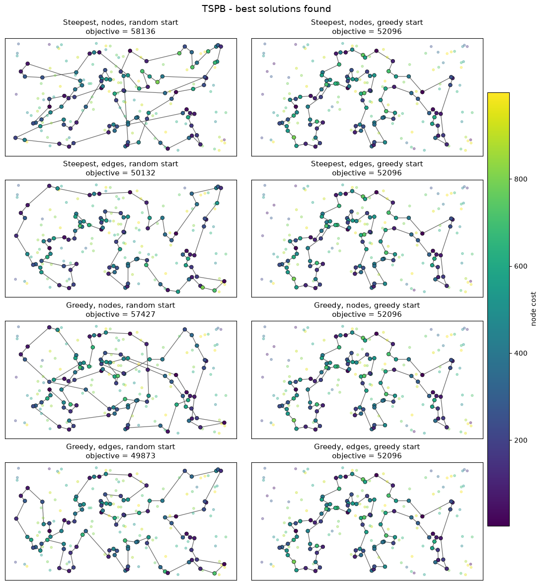

# Evolutionary Computation - Assignment 3 (local search)

Authors:
1. Name: Tomasz Preś  Index number: 160305
2. Name: Marek Olejniczak  Index number: 160303

## Problem

We are given three columns of integers with a row for each node. The first two columns contain x
and y coordinates of the node positions in a plane. The third column contains node costs. The goal is
to select exactly 50% of the nodes (if the number of nodes is odd we round the number of nodes to
be selected up) and form a Hamiltonian cycle (closed path) through this set of nodes such that the
sum of the total length of the path plus the total cost of the selected nodes is minimized.

The distances between nodes are calculated as Euclidean distances rounded mathematically to
integer values. The distance matrix is calculated just after reading an instance and then only
the distance matrix (no nodes coordinates) is accessed by the optimization methods.

## Algorithms (pseudocode)

All methods from assignments 1 and 2 are included in the tables (re-implemented in C++, so that all
running times were measured in the same way; the objective values of the constructive methods are
identical to the previous reports, only *Random* differs because another random generator was used).

### Neighborhood

The solution is a cycle `t[0..K-1]` (K = 100) of selected nodes; the other nodes are unselected.
Three kinds of moves, only the change of the objective (delta) is calculated, never the whole objective.

```
d = distance, c = node cost, all indices modulo K.
For a node x at position i:  pred(x) = t[i-1],  succ(x) = t[i+1].

inter-route (K*(n-K) = 10000 moves):
    replace selected a = t[i] by an unselected v
    delta = d(pred(a), v) + d(v, succ(a))
          - d(pred(a), a) - d(a, succ(a))
          + c(v) - c(a)

intra-route, two nodes exchange (4950 moves):
    swap a = t[i] and b = t[j]
    delta = d(pred(a), b) + d(b, succ(a))
          + d(pred(b), a) + d(a, succ(b))
          - d(pred(a), a) - d(a, succ(a))
          - d(pred(b), b) - d(b, succ(b))
    (if a and b are neighbours, the edge between them
     is unchanged and is not counted)

intra-route, two edges exchange (4850 moves):
    remove edges (t[i], t[i+1]) and (t[j], t[j+1]),
    reconnect by reversing the segment t[i+1..j]
    delta = d(t[i], t[j]) + d(t[i+1], t[j+1])
          - d(t[i], t[i+1]) - d(t[j], t[j+1])
```

(Pairs of edges that share a node give no change of the cycle, so they are excluded from the edge exchange.)
The inter-route moves and the intra-route moves together are one neighborhood of ~14900 moves.
Cost of a node selected / not selected changes only in the inter-route move.

### Steepest local search

```
x = starting solution
loop:
    best = none
    for each move m in the whole neighborhood (inter + intra):
        if delta(m) < best.delta (and < 0): best = m
    if best is none: stop (local optimum)
    apply best
```

### Greedy local search

```
x = starting solution
loop:
    browse all moves (inter + intra together) in a random order:
        evaluate delta(m) of the next move
        if delta(m) < 0: apply m, go to the next iteration of the loop
    if no move improved: stop (local optimum)
```

**Randomization.** The moves of both kinds are indexed by one common range `0 .. M-1`
(first the 10000 inter-route moves, then the intra-route pairs). In every iteration the
index range is browsed in a new, uniformly random permutation, so the two kinds of moves are
mixed (it never starts from a given kind). The permutation is not generated in advance: it is
produced lazily with the Fisher-Yates shuffle, one step for every move that is going to be
evaluated (`swap(perm[q], perm[q + rand(M - q)])`, then evaluate `perm[q]`). Thanks to this,
only the moves up to the first improving one are evaluated, and also the cost of the randomization
itself is proportional to the number of evaluated moves (our first version shuffled the whole
array in every iteration, which cost as much as evaluating all deltas, so greedy was not faster).

### Starting solutions

- random: 200 random solutions (random 100 nodes in random order); the same 200 solutions are used
  by all four methods with random starts, so the comparison is paired,
- greedy: the best method from assignments 1-2, i.e. the weighted sum regret heuristic (greedy cycle,
  weights 1:2, i.e. regret - 2 * best insertion cost, which had the best average on both instances), started from each of the 200 nodes.

Every method was run 200 times. The time of one run includes creating the starting solution
(for greedy starts this is the construction heuristic, about 1.5 ms of the total). The additional
table shows the number of evaluated moves (deltas) in one run, which does not depend on the
implementation. C++ (g++ -O2), one thread, wall-clock time of every run measured separately.

## Results

Cells: average (min – max). Bold = best average and best minimum in the column, underlined = methods
from the current assignment.

### Objective function

| Method | TSPA | TSPB |
|---|---|---|
| Random | 261332.1 (233090 – 292399) | 207232.3 (184861 – 226897) |
| NN (end only) | 87476.6 (84362 – 90075) | 59397.3 (56007 – 63166) |
| NN (any position) | 74306.5 (72328 – 77022) | 59476.2 (52915 – 66164) |
| Greedy cycle | 73728.7 (72590 – 75281) | 59710.4 (53016 – 63736) |
| 2-regret (NN any) | 121360.3 (110950 – 135771) | 73649.8 (68761 – 79756) |
| 2-regret (greedy cycle) | 120367.5 (110303 – 128089) | 72368.0 (67078 – 76382) |
| Weighted (NN any) | 75549.4 (72419 – 78504) | 55698.9 (50485 – 61406) |
| Weighted (greedy cycle) | 73348.7 (72011 – 75532) | 57892.5 (52731 – 63370) |
| Weighted (greedy cycle, 1:2) | 73191.4 (72049 – 75212) | 55667.6 (52099 – 62556) |
| <u>Steepest, nodes, random start</u> | 90301.3 (84408 – 96984) | 66169.3 (58136 – 73227) |
| <u>Steepest, nodes, greedy start</u> | 72861.6 (71955 – 75044) | 55116.7 (52096 – 62323) |
| <u>Steepest, edges, random start</u> | 76237.3 (73654 – 79812) | **52575.6** (50132 – 55820) |
| <u>Steepest, edges, greedy start</u> | **72811.3** (**71925** – 74680) | 54861.7 (52096 – 62039) |
| <u>Greedy, nodes, random start</u> | 88132.5 (82514 – 96313) | 63778.0 (57427 – 70983) |
| <u>Greedy, nodes, greedy start</u> | 72861.5 (71955 – 75044) | 55114.2 (52096 – 62323) |
| <u>Greedy, edges, random start</u> | 76146.8 (73779 – 78842) | 52940.4 (**49873** – 56263) |
| <u>Greedy, edges, greedy start</u> | 72820.3 (71955 – 74680) | 54788.1 (52096 – 61860) |

### Running time [ms] per run

| Method | TSPA | TSPB |
|---|---|---|
| Random | **0.001** (**0.001** – 0.001) | **0.001** (**0.001** – 0.001) |
| NN (end only) | 0.026 (0.021 – 0.055) | 0.024 (0.021 – 0.030) |
| NN (any position) | 1.413 (1.289 – 1.621) | 1.427 (1.301 – 1.738) |
| Greedy cycle | 1.386 (1.335 – 1.472) | 1.390 (1.330 – 1.438) |
| 2-regret (NN any) | 1.326 (1.221 – 1.493) | 1.334 (1.217 – 1.413) |
| 2-regret (greedy cycle) | 1.543 (1.434 – 1.652) | 1.550 (1.463 – 1.630) |
| Weighted (NN any) | 1.493 (1.372 – 2.122) | 1.490 (1.366 – 1.786) |
| Weighted (greedy cycle) | 1.548 (1.439 – 4.511) | 1.503 (1.398 – 1.604) |
| Weighted (greedy cycle, 1:2) | 1.509 (1.429 – 1.622) | 1.497 (1.392 – 1.596) |
| <u>Steepest, nodes, random start</u> | 21.187 (17.724 – 25.840) | 21.171 (16.894 – 26.804) |
| <u>Steepest, nodes, greedy start</u> | 2.049 (1.715 – 3.076) | 2.726 (1.698 – 3.971) |
| <u>Steepest, edges, random start</u> | 12.901 (11.128 – 15.808) | 13.089 (11.117 – 16.008) |
| <u>Steepest, edges, greedy start</u> | 1.907 (1.628 – 2.601) | 2.512 (1.676 – 3.473) |
| <u>Greedy, nodes, random start</u> | 2.285 (1.227 – 5.067) | 2.233 (1.149 – 4.748) |
| <u>Greedy, nodes, greedy start</u> | 1.997 (1.682 – 2.661) | 2.304 (1.738 – 3.246) |
| <u>Greedy, edges, random start</u> | 1.409 (0.864 – 2.012) | 1.390 (0.883 – 2.297) |
| <u>Greedy, edges, greedy start</u> | 1.976 (1.679 – 2.704) | 2.257 (1.796 – 3.471) |

### Running time [ms] per run, local search only (without creating the starting solution)

| Method | TSPA | TSPB |
|---|---|---|
| <u>Steepest, nodes, random start</u> | 21.185 (17.723 – 25.838) | 21.170 (16.893 – 26.802) |
| <u>Steepest, nodes, greedy start</u> | 0.530 (0.269 – 1.535) | 1.222 (**0.141** – 2.396) |
| <u>Steepest, edges, random start</u> | 12.899 (11.126 – 15.806) | 13.088 (11.116 – 16.006) |
| <u>Steepest, edges, greedy start</u> | **0.399** (**0.188** – 1.133) | 1.023 (0.190 – 1.979) |
| <u>Greedy, nodes, random start</u> | 2.284 (1.225 – 5.065) | 2.231 (1.147 – 4.747) |
| <u>Greedy, nodes, greedy start</u> | 0.490 (0.238 – 1.174) | 0.806 (0.253 – 1.705) |
| <u>Greedy, edges, random start</u> | 1.408 (0.862 – 2.010) | 1.388 (0.881 – 2.295) |
| <u>Greedy, edges, greedy start</u> | 0.459 (0.213 – 1.228) | **0.756** (0.289 – 1.949) |

### Number of evaluated moves per run (local search only)

| Method | TSPA | TSPB |
|---|---|---|
| <u>Steepest, nodes, random start</u> | 2292657 (1913600 – 2855450) | 2285780 (1868750 – 2885350) |
| <u>Steepest, nodes, greedy start</u> | 56885 (29900 – 164450) | 130439 (**14950** – 254150) |
| <u>Steepest, edges, random start</u> | 1978762 (1707750 – 2390850) | 1997399 (1707750 – 2227500) |
| <u>Steepest, edges, greedy start</u> | 61108 (29700 – 178200) | 155851 (29700 – 297000) |
| <u>Greedy, nodes, random start</u> | 138364 (76426 – 309514) | 135130 (70927 – 283451) |
| <u>Greedy, nodes, greedy start</u> | **30048** (**15049** – 73115) | **48996** (**14950** – 101092) |
| <u>Greedy, edges, random start</u> | 98825 (60111 – 140045) | 97427 (60483 – 161382) |
| <u>Greedy, edges, greedy start</u> | 32649 (15066 – 86313) | 53372 (20137 – 135033) |

## Best solutions

Color of a node = its cost (bigger, outlined dots are the selected nodes).

### TSPA



TSPA, Steepest, nodes, random start: 84408

```
[16, 156, 28, 35, 67, 176, 170, 146, 159, 130, 174, 179, 53, 144, 51, 76, 132, 189, 2, 171, 187, 30, 152, 108, 60, 116, 149, 63, 168, 127, 97, 49, 160, 123, 180, 141, 87, 102, 185, 45, 73, 58, 84, 99, 177, 140, 135, 114, 181, 192, 158, 134, 138, 182, 57, 64, 88, 153, 107, 89, 42, 151, 150, 106, 43, 113, 93, 50, 169, 1, 85, 142, 33, 4, 91, 80, 31, 48, 157, 71, 112, 139, 52, 36, 131, 54, 9, 101, 147, 47, 3, 8, 194, 164, 184, 178, 29, 136, 186, 62]
```

TSPA, Steepest, nodes, greedy start: 71955

```
[101, 55, 29, 178, 184, 136, 186, 164, 1, 169, 3, 50, 93, 85, 174, 8, 54, 9, 33, 131, 36, 177, 52, 179, 53, 140, 144, 67, 16, 51, 35, 185, 102, 28, 180, 132, 76, 4, 71, 157, 91, 80, 48, 31, 108, 152, 100, 123, 83, 160, 49, 60, 116, 149, 63, 168, 97, 127, 161, 30, 187, 171, 2, 189, 141, 87, 45, 73, 135, 114, 181, 192, 158, 58, 84, 134, 72, 176, 150, 106, 113, 89, 42, 151, 138, 182, 57, 64, 107, 88, 78, 193, 153, 170, 146, 159, 130, 47, 37, 147]
```

TSPA, Steepest, edges, random start: 73654

```
[53, 140, 41, 58, 84, 134, 72, 176, 151, 42, 89, 113, 106, 150, 174, 194, 8, 142, 85, 164, 186, 136, 178, 29, 55, 101, 1, 169, 3, 50, 93, 147, 47, 130, 159, 153, 78, 88, 107, 57, 182, 158, 192, 181, 135, 73, 45, 185, 102, 87, 28, 180, 141, 30, 187, 189, 2, 171, 104, 129, 69, 127, 97, 160, 83, 123, 100, 152, 108, 49, 168, 63, 149, 116, 60, 31, 48, 80, 91, 157, 71, 132, 76, 4, 112, 139, 51, 16, 156, 35, 67, 144, 52, 33, 9, 54, 131, 36, 177, 179]
```

TSPA, Steepest, edges, greedy start: 71925

```
[90, 100, 152, 108, 60, 31, 48, 80, 38, 91, 157, 71, 4, 76, 132, 180, 28, 102, 185, 35, 156, 51, 16, 67, 144, 140, 53, 179, 52, 177, 36, 131, 33, 9, 54, 8, 142, 164, 186, 136, 163, 29, 101, 178, 1, 169, 3, 50, 93, 47, 130, 159, 146, 170, 153, 193, 78, 88, 107, 64, 57, 182, 138, 151, 42, 89, 113, 106, 150, 174, 176, 72, 134, 84, 58, 158, 192, 181, 114, 135, 73, 45, 87, 141, 189, 2, 171, 187, 30, 161, 127, 97, 168, 116, 149, 63, 49, 160, 83, 123]
```

TSPA, Greedy, nodes, random start: 82514

```
[161, 30, 11, 63, 149, 49, 152, 160, 83, 123, 90, 132, 76, 187, 189, 141, 102, 185, 52, 33, 54, 131, 36, 177, 179, 144, 16, 51, 35, 156, 180, 28, 87, 114, 181, 192, 88, 78, 153, 47, 147, 1, 178, 29, 163, 136, 186, 164, 142, 8, 174, 106, 113, 89, 42, 150, 151, 182, 57, 64, 107, 159, 130, 93, 50, 3, 85, 9, 143, 112, 48, 60, 116, 168, 129, 69, 127, 97, 108, 80, 91, 157, 71, 4, 67, 53, 140, 61, 41, 84, 134, 72, 176, 158, 58, 135, 73, 45, 2, 171]
```

TSPA, Greedy, nodes, greedy start: 71955

```
[101, 55, 29, 178, 184, 136, 186, 164, 1, 169, 3, 50, 93, 85, 174, 8, 54, 9, 33, 131, 36, 177, 52, 179, 53, 140, 144, 67, 16, 51, 35, 185, 102, 28, 180, 132, 76, 4, 71, 157, 91, 80, 48, 31, 108, 152, 100, 123, 83, 160, 49, 60, 116, 149, 63, 168, 97, 127, 161, 30, 187, 171, 2, 189, 141, 87, 45, 73, 135, 114, 181, 192, 158, 58, 84, 134, 72, 176, 150, 106, 113, 89, 42, 151, 138, 182, 57, 64, 107, 88, 78, 193, 153, 170, 146, 159, 130, 47, 37, 147]
```

TSPA, Greedy, edges, random start: 73779

```
[99, 131, 36, 177, 179, 53, 140, 45, 73, 135, 58, 181, 114, 98, 87, 28, 180, 141, 30, 187, 189, 2, 171, 104, 129, 69, 127, 97, 168, 116, 149, 63, 11, 49, 60, 31, 48, 80, 108, 152, 123, 90, 132, 76, 71, 157, 112, 139, 51, 16, 35, 185, 67, 144, 52, 33, 9, 54, 194, 8, 142, 164, 136, 163, 29, 101, 178, 1, 169, 3, 50, 147, 47, 130, 159, 146, 170, 153, 193, 78, 88, 107, 57, 182, 192, 158, 138, 151, 150, 42, 89, 113, 106, 93, 85, 174, 176, 72, 134, 84]
```

TSPA, Greedy, edges, greedy start: 71955

```
[55, 101, 147, 37, 47, 130, 159, 146, 170, 153, 193, 78, 88, 107, 64, 57, 182, 138, 151, 42, 89, 113, 106, 150, 176, 72, 134, 84, 58, 158, 192, 181, 114, 135, 73, 45, 87, 141, 189, 2, 171, 187, 30, 161, 127, 97, 168, 63, 149, 116, 60, 49, 160, 83, 123, 100, 152, 108, 31, 48, 80, 91, 157, 71, 4, 76, 132, 180, 28, 102, 185, 35, 51, 16, 67, 144, 140, 53, 179, 52, 177, 36, 131, 33, 9, 54, 8, 174, 85, 93, 50, 3, 169, 1, 164, 186, 136, 184, 178, 29]
```

### TSPB



TSPB, Steepest, nodes, random start: 58136

```
[81, 169, 187, 18, 70, 190, 194, 57, 89, 72, 46, 179, 82, 87, 88, 67, 66, 192, 54, 78, 10, 114, 104, 144, 185, 79, 76, 135, 86, 96, 198, 121, 130, 158, 145, 28, 149, 30, 21, 38, 140, 97, 115, 6, 29, 132, 170, 125, 154, 47, 69, 160, 133, 120, 117, 8, 136, 172, 64, 40, 60, 71, 155, 197, 1, 174, 175, 134, 45, 85, 59, 73, 51, 167, 181, 80, 127, 129, 90, 52, 153, 14, 2, 20, 74, 171, 99, 24, 34, 152, 151, 122, 184, 3, 162, 196, 139, 61, 105, 94]
```

TSPB, Steepest, nodes, greedy start: 52096

```
[91, 36, 197, 132, 29, 6, 180, 115, 170, 177, 125, 26, 154, 140, 38, 176, 30, 183, 191, 130, 63, 121, 198, 96, 48, 43, 156, 89, 57, 79, 185, 104, 54, 196, 114, 10, 90, 14, 2, 74, 20, 153, 182, 52, 129, 127, 80, 192, 162, 76, 135, 27, 11, 66, 67, 24, 34, 152, 181, 88, 179, 87, 82, 167, 51, 85, 59, 73, 98, 151, 122, 173, 184, 3, 86, 46, 72, 117, 8, 120, 133, 136, 172, 160, 69, 168, 189, 21, 47, 97, 155, 71, 141, 40, 60, 157, 45, 134, 175, 62]
```

TSPB, Steepest, edges, random start: 50132

```
[46, 72, 120, 8, 133, 136, 172, 160, 69, 189, 183, 130, 191, 30, 176, 21, 38, 47, 140, 154, 26, 125, 177, 170, 115, 180, 6, 71, 40, 60, 45, 134, 175, 36, 197, 29, 132, 178, 65, 145, 28, 149, 116, 147, 121, 198, 96, 89, 57, 185, 76, 104, 162, 192, 54, 187, 70, 81, 94, 105, 61, 196, 114, 10, 90, 129, 127, 80, 52, 182, 153, 14, 110, 93, 9, 2, 20, 74, 17, 171, 99, 31, 67, 24, 34, 152, 181, 179, 87, 82, 85, 51, 167, 73, 59, 98, 151, 3, 184, 86]
```

TSPB, Steepest, edges, greedy start: 52096

```
[91, 36, 197, 132, 29, 6, 180, 115, 170, 177, 125, 26, 154, 140, 38, 176, 30, 183, 191, 130, 63, 121, 198, 96, 48, 43, 156, 89, 57, 79, 185, 104, 54, 196, 114, 10, 90, 14, 2, 74, 20, 153, 182, 52, 129, 127, 80, 192, 162, 76, 135, 27, 11, 66, 67, 24, 34, 152, 181, 88, 179, 87, 82, 167, 51, 85, 59, 73, 98, 151, 122, 173, 184, 3, 86, 46, 72, 117, 8, 120, 133, 136, 172, 160, 69, 168, 189, 21, 47, 97, 155, 71, 141, 40, 60, 157, 45, 134, 175, 62]
```

TSPB, Greedy, nodes, random start: 57427

```
[150, 52, 129, 127, 54, 86, 72, 120, 133, 136, 172, 184, 3, 185, 104, 190, 70, 187, 196, 114, 10, 90, 20, 74, 2, 110, 14, 153, 182, 80, 192, 162, 46, 117, 8, 173, 151, 122, 160, 69, 47, 97, 141, 40, 60, 71, 155, 170, 115, 180, 6, 29, 132, 175, 134, 45, 157, 85, 51, 167, 181, 152, 34, 25, 73, 59, 64, 125, 145, 28, 149, 116, 147, 130, 191, 176, 21, 38, 140, 154, 26, 30, 183, 189, 63, 121, 198, 96, 48, 89, 57, 76, 66, 67, 24, 179, 82, 87, 99, 171]
```

TSPB, Greedy, nodes, greedy start: 52096

```
[91, 36, 197, 132, 29, 6, 180, 115, 170, 177, 125, 26, 154, 140, 38, 176, 30, 183, 191, 130, 63, 121, 198, 96, 48, 43, 156, 89, 57, 79, 185, 104, 54, 196, 114, 10, 90, 14, 2, 74, 20, 153, 182, 52, 129, 127, 80, 192, 162, 76, 135, 27, 11, 66, 67, 24, 34, 152, 181, 88, 179, 87, 82, 167, 51, 85, 59, 73, 98, 151, 122, 173, 184, 3, 86, 46, 72, 117, 8, 120, 133, 136, 172, 160, 69, 168, 189, 21, 47, 97, 155, 71, 141, 40, 60, 157, 45, 134, 175, 62]
```

TSPB, Greedy, edges, random start: 49873

```
[145, 65, 178, 103, 132, 29, 197, 6, 180, 155, 71, 175, 134, 45, 60, 40, 33, 64, 85, 59, 73, 167, 51, 82, 87, 179, 181, 152, 25, 34, 24, 66, 67, 99, 39, 171, 74, 20, 2, 93, 110, 14, 153, 90, 129, 127, 80, 192, 162, 54, 10, 114, 196, 105, 94, 81, 70, 190, 104, 185, 76, 135, 3, 184, 151, 122, 69, 160, 172, 136, 133, 8, 117, 120, 72, 46, 86, 57, 89, 48, 96, 198, 121, 130, 191, 30, 183, 21, 38, 47, 140, 154, 97, 115, 170, 125, 177, 158, 149, 28]
```

TSPB, Greedy, edges, greedy start: 52096

```
[91, 36, 197, 132, 29, 6, 180, 115, 170, 177, 125, 26, 154, 140, 38, 176, 30, 183, 191, 130, 63, 121, 198, 96, 48, 43, 156, 89, 57, 79, 185, 104, 54, 196, 114, 10, 90, 14, 2, 74, 20, 153, 182, 52, 129, 127, 80, 192, 162, 76, 135, 27, 11, 66, 67, 24, 34, 152, 181, 88, 179, 87, 82, 167, 51, 85, 59, 73, 98, 151, 122, 173, 184, 3, 86, 46, 72, 117, 8, 120, 133, 136, 172, 160, 69, 168, 189, 21, 47, 97, 155, 71, 141, 40, 60, 157, 45, 134, 175, 62]
```


## Checker

Yes, all the best solutions were checked with the solution checker (in C++ and independently in
Python from the coordinates), values are the same.

## Code

ls.cpp (C++, standard library only). Link: https://github.com/tomasz-pres/evolutionary-computing.git

## Conclusions

- **Edges vs nodes.** The two-edges exchange is much better from random starts (avg TSPA ~76.2k vs ~88-90k,
  TSPB ~52.6-52.9k vs ~63.8-66.2k): reversing a segment removes the crossing edges that random tours are full
  of. From greedy starts the difference is negligible (TSPA 72811 vs 72862).
- **Steepest vs greedy: quality.** Practically the same (differences below 1% from random starts, ~0.1% from
  greedy starts), so taking the first improving move instead of the best one costs almost nothing.
- **Steepest vs greedy: time.** From random starts greedy is about 9x faster (TSPA nodes 2.3 vs 21.1 ms, edges
  1.4 vs 12.9 ms) and evaluates 17-20x fewer moves; the time gain is smaller because one greedy evaluation is
  ~2x more expensive (random number, random memory access). From greedy starts the search is short
  (0.4-1.2 ms of ~2-2.7 ms) and dominated by the construction (~1.5 ms); both versions also have to scan the
  whole neighborhood once at the end to confirm the local optimum, so greedy saves only ~2x evaluations, which
  the costlier evaluation cancels. Greedy is therefore faster in 3 of 4 such cases, but not in TSPA edges
  (1.98 vs 1.91 ms).
- **Random vs greedy starts.** Greedy starts are much better on TSPA and faster to improve
  (~2 ms vs 13-21 ms). The exception is TSPB with edges: random starts (avg 52.6k steepest, 52.9k greedy)
  beat greedy starts (54.8-55.1k) and all constructive methods (best 55.7k), and give the best TSPB solution
  (49873) - the greedy start sticks near its own local optimum, while random starts are more diverse.
- **Gain over the heuristic.** Local search from the greedy start improves it only a little (TSPA 73191 -> 72820,
  TSPB 55668 -> 54788) but cheaply (+0.4-1.2 ms).
- **Overall.** Best average on TSPA: steepest with edges from greedy starts (72811, greedy 72820); on TSPB:
  steepest with edges from random starts (52576). Greedy with edges from random starts is only 0.7% worse
  on TSPB and 9x faster, so it has the best quality/time trade-off.
