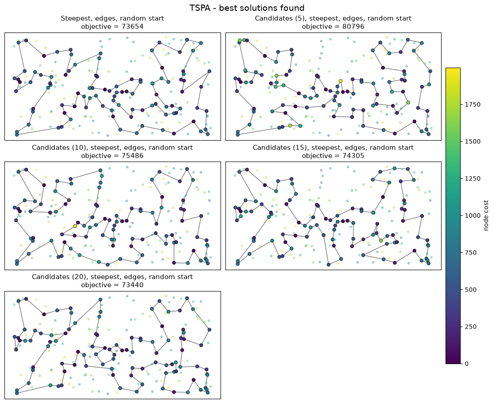
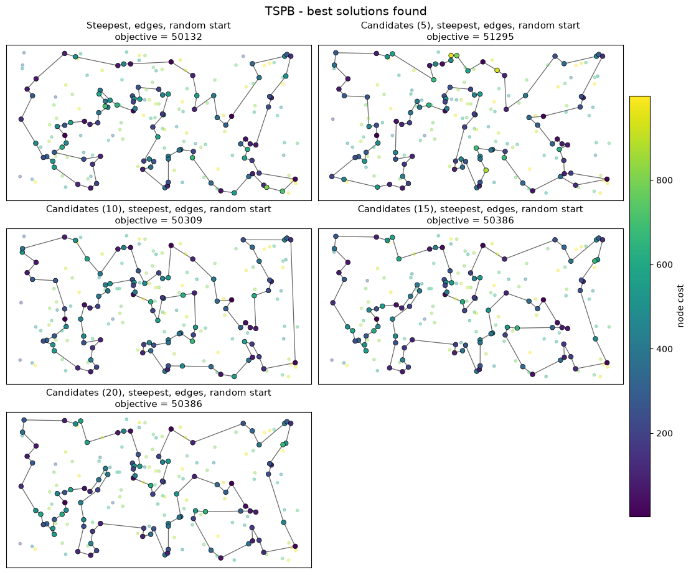

# Evolutionary Computation - Assignment 4 (candidate moves in local search)

Authors:
1. Name: Tomasz Preś  Index number: 160305
2. Name: Marek Olejniczak  Index number: 160303

## Problem

We are given three columns of integers with a row for each node. The first two columns contain x
and y coordinates of the node positions in a plane. The third column contains node costs. The goal is
to select exactly 50% of the nodes (if the number of nodes is odd we round the number of nodes to
be selected up) and form a Hamiltonian cycle (closed path) through this set of nodes such that the
sum of the total length of the path plus the total cost of the selected nodes is minimized.

The distances between nodes are calculated as Euclidean distances rounded mathematically to
integer values. The distance matrix is calculated just after reading an instance and then only
the distance matrix (no nodes coordinates) is accessed by the optimization methods.

## Algorithms (pseudocode)

We use the neighborhood that was the best in assignment 3: inter-route exchange (selected node <->
not selected node) + intra-route two-edges exchange, steepest version, random starting solutions.

### Baseline: steepest local search (from assignment 3)

```
x = random solution
loop:
    evaluate ALL moves: K*(n-K) = 10000 node exchanges + 4850 two-edges exchanges
    if the best delta < 0: apply it, else stop
```

Same code as in assignment 3 (only the distance matrix is stored as one flat array), it gives exactly
the same results as there (same random starting solutions, same values and numbers of evaluated moves
in all 400 runs).

### Candidate edges

```
for each node a:
    near[a] = the 10 nodes b != a with the smallest  d(a, b) + cost(b)
candidate edge = (a, b) with b in near[a]
```

The lists are computed once per instance, before the local search (not counted in the time).

### Candidate moves

A move is a candidate move if it adds at least one candidate edge to the solution. We do not go through
all moves and filter them, we generate only the candidate moves:

```
for each selected node a (position i):        pred/succ = neighbours in the cycle
    for each b in near[a]:
        if b is selected:
            # two-edges exchanges that add edge (a, b)
            remove (a, succ a), (b, succ b), add (a, b), (succ a, succ b)
                delta = d(a,b) + d(succ a, succ b) - d(a, succ a) - d(b, succ b)
            remove (pred a, a), (pred b, b), add (pred a, pred b), (a, b)
                delta = d(pred a, pred b) + d(a,b) - d(pred a, a) - d(pred b, b)
            (skipped if the two removed edges share a node)
        else:
            # node exchanges that add edge (a, b) - b replaces a NEIGHBOUR of a, not a itself
            replace succ a by b: new edges (a, b), (b, succ succ a)
                delta = d(a,b) + d(b, succ succ a) - d(a, succ a) - d(succ a, succ succ a) + c(b) - c(succ a)
            replace pred a by b: new edges (pred pred a, b), (b, a)
                delta = d(pred pred a, b) + d(b,a) - d(pred pred a, pred a) - d(pred a, a) + c(b) - c(pred a)
```

So there are 2 moves for every candidate edge, ~K * 10 * 2 = 2000 moves per iteration instead of 14850.
Positions of the nodes are kept in an array `pos[node]` (-1 = not selected), so checking if b is
selected and finding its neighbours is O(1).

### Steepest local search with candidate moves

```
x = random solution
loop:
    evaluate all candidate moves (above)
    if the best delta < 0: apply it (update pos[]), else stop
```

The size of the lists (10) was also tested experimentally: 5, 10, 15, 20.

**Correctness checks.** (1) with lists of all 199 nodes the candidate moves are the whole neighborhood:
all 400 results were local optima of the full neighborhood (results differ from the baseline only in
23/200 runs because of ties - equal deltas evaluated in a different order); (2) in a test build (50 runs of every method) every
applied move was checked: the real change of the objective = the computed delta.

Every method was run 200 times from the same 200 random solutions (the same ones as in assignment 3).
C++ (g++ -O2), one thread, wall-clock time of every run measured separately.

## Results

Cells: average (min – max). Bold = best average and best minimum in the column, underlined = methods
from the current assignment.

### Objective function

Methods from assignments 1-3: values from assignment 3 (they do not depend on the computer).

| Method | TSPA | TSPB |
|---|---|---|
| Random | 261332.1 (233090 – 292399) | 207232.3 (184861 – 226897) |
| NN (end only) | 87476.6 (84362 – 90075) | 59397.3 (56007 – 63166) |
| NN (any position) | 74306.5 (72328 – 77022) | 59476.2 (52915 – 66164) |
| Greedy cycle | 73728.7 (72590 – 75281) | 59710.4 (53016 – 63736) |
| 2-regret (NN any) | 121360.3 (110950 – 135771) | 73649.8 (68761 – 79756) |
| 2-regret (greedy cycle) | 120367.5 (110303 – 128089) | 72368.0 (67078 – 76382) |
| Weighted (NN any) | 75549.4 (72419 – 78504) | 55698.9 (50485 – 61406) |
| Weighted (greedy cycle) | 73348.7 (72011 – 75532) | 57892.5 (52731 – 63370) |
| Weighted (greedy cycle, 1:2) | 73191.4 (72049 – 75212) | 55667.6 (52099 – 62556) |
| Steepest, nodes, random start | 90301.3 (84408 – 96984) | 66169.3 (58136 – 73227) |
| Steepest, nodes, greedy start | 72861.6 (71955 – 75044) | 55116.7 (52096 – 62323) |
| Steepest, edges, greedy start | **72811.3** (**71925** – 74680) | 54861.7 (52096 – 62039) |
| Greedy, nodes, random start | 88132.5 (82514 – 96313) | 63778.0 (57427 – 70983) |
| Greedy, nodes, greedy start | 72861.5 (71955 – 75044) | 55114.2 (52096 – 62323) |
| Greedy, edges, random start | 76146.8 (73779 – 78842) | 52940.4 (**49873** – 56263) |
| Greedy, edges, greedy start | 72820.3 (71955 – 74680) | 54788.1 (52096 – 61860) |
| Steepest, edges, random start | 76237.3 (73654 – 79812) | 52575.6 (50132 – 55820) |
| <u>Candidates (5), steepest, edges, random start</u> | 86638.6 (80796 – 92972) | 54002.9 (51295 – 56776) |
| <u>Candidates (10), steepest, edges, random start</u> | 80057.2 (75486 – 88182) | **52565.1** (50309 – 56225) |
| <u>Candidates (15), steepest, edges, random start</u> | 77511.3 (74305 – 82280) | 52600.3 (50386 – 54831) |
| <u>Candidates (20), steepest, edges, random start</u> | 76607.3 (73440 – 80446) | 52627.9 (50386 – 54972) |

### Running time [ms] per run

Only the methods run in this assignment (on the same computer).

| Method | TSPA | TSPB |
|---|---|---|
| Steepest, edges, random start | 3.208 (2.730 – 6.188) | 3.196 (2.711 – 4.029) |
| <u>Candidates (5), steepest, edges, random start</u> | **0.332** (**0.288** – 0.393) | **0.338** (**0.280** – 0.382) |
| <u>Candidates (10), steepest, edges, random start</u> | 0.628 (0.540 – 0.706) | 0.643 (0.572 – 0.826) |
| <u>Candidates (15), steepest, edges, random start</u> | 0.934 (0.822 – 1.430) | 0.974 (0.823 – 1.169) |
| <u>Candidates (20), steepest, edges, random start</u> | 1.424 (1.093 – 4.001) | 1.481 (1.095 – 12.349) |

### Running time [ms] per run, local search only (without creating the starting solution)

| Method | TSPA | TSPB |
|---|---|---|
| Steepest, edges, random start | 3.206 (2.728 – 6.186) | 3.195 (2.709 – 4.028) |
| <u>Candidates (5), steepest, edges, random start</u> | **0.330** (**0.287** – 0.391) | **0.337** (**0.278** – 0.380) |
| <u>Candidates (10), steepest, edges, random start</u> | 0.626 (0.538 – 0.705) | 0.641 (0.571 – 0.824) |
| <u>Candidates (15), steepest, edges, random start</u> | 0.932 (0.821 – 1.429) | 0.972 (0.822 – 1.168) |
| <u>Candidates (20), steepest, edges, random start</u> | 1.422 (1.092 – 3.999) | 1.479 (1.093 – 12.346) |

### Number of evaluated moves per run

| Method | TSPA | TSPB |
|---|---|---|
| Steepest, edges, random start | 1978762 (1707750 – 2390850) | 1997399 (1707750 – 2227500) |
| <u>Candidates (5), steepest, edges, random start</u> | **120980** (**106000** – 145000) | **127345** (**107000** – 146000) |
| <u>Candidates (10), steepest, edges, random start</u> | 251100 (212000 – 282000) | 266510 (230000 – 312000) |
| <u>Candidates (15), steepest, edges, random start</u> | 390135 (345000 – 453000) | 403230 (345000 – 450000) |
| <u>Candidates (20), steepest, edges, random start</u> | 527940 (452000 – 604000) | 537840 (460000 – 600000) |

## Best solutions

Color of a node = its cost (bigger, outlined dots are the selected nodes).

### TSPA



TSPA, Steepest, edges, random start: 73654

```
[53, 140, 41, 58, 84, 134, 72, 176, 151, 42, 89, 113, 106, 150, 174, 194, 8, 142, 85, 164, 186, 136, 178, 29, 55, 101, 1, 169, 3, 50, 93, 147, 47, 130, 159, 153, 78, 88, 107, 57, 182, 158, 192, 181, 135, 73, 45, 185, 102, 87, 28, 180, 141, 30, 187, 189, 2, 171, 104, 129, 69, 127, 97, 160, 83, 123, 100, 152, 108, 49, 168, 63, 149, 116, 60, 31, 48, 80, 91, 157, 71, 132, 76, 4, 112, 139, 51, 16, 156, 35, 67, 144, 52, 33, 9, 54, 131, 36, 177, 179]
```

TSPA, Candidates (5), steepest, edges, random start: 80796

```
[108, 152, 60, 82, 31, 199, 7, 48, 80, 38, 91, 157, 71, 76, 132, 44, 90, 123, 148, 162, 180, 28, 102, 185, 35, 51, 16, 67, 144, 179, 52, 74, 177, 36, 131, 33, 9, 54, 8, 174, 72, 176, 106, 89, 117, 93, 81, 85, 3, 50, 169, 1, 164, 186, 136, 184, 178, 29, 55, 101, 147, 37, 47, 130, 159, 153, 78, 88, 107, 57, 182, 158, 134, 84, 58, 135, 41, 140, 53, 45, 87, 141, 30, 161, 187, 10, 166, 2, 171, 104, 129, 69, 127, 97, 168, 116, 149, 63, 11, 49]
```

TSPA, Candidates (10), steepest, edges, random start: 75486

```
[153, 170, 146, 159, 130, 47, 93, 50, 3, 1, 101, 29, 178, 136, 186, 164, 142, 174, 8, 54, 9, 33, 36, 177, 52, 179, 53, 140, 61, 135, 73, 45, 144, 67, 185, 102, 87, 141, 30, 191, 180, 28, 35, 16, 51, 139, 112, 5, 115, 157, 71, 91, 38, 76, 132, 90, 123, 49, 152, 80, 48, 31, 108, 60, 116, 149, 63, 168, 95, 97, 127, 129, 104, 69, 161, 171, 2, 187, 189, 10, 25, 114, 181, 192, 158, 58, 84, 134, 176, 151, 150, 106, 89, 42, 57, 64, 107, 88, 78, 193]
```

TSPA, Candidates (15), steepest, edges, random start: 74305

```
[48, 31, 108, 60, 149, 116, 168, 119, 63, 11, 49, 152, 123, 83, 160, 97, 127, 129, 104, 69, 161, 171, 2, 189, 187, 30, 141, 87, 102, 185, 45, 114, 181, 135, 73, 140, 53, 179, 177, 36, 131, 84, 58, 134, 72, 174, 176, 0, 150, 106, 89, 42, 151, 158, 182, 57, 107, 88, 78, 193, 153, 170, 146, 159, 130, 47, 93, 50, 3, 169, 1, 178, 101, 29, 163, 136, 186, 184, 164, 8, 194, 54, 9, 33, 52, 144, 67, 16, 51, 35, 28, 180, 132, 76, 4, 71, 157, 91, 38, 80]
```

TSPA, Candidates (20), steepest, edges, random start: 73440

```
[28, 87, 73, 135, 181, 192, 158, 58, 84, 134, 176, 150, 106, 43, 89, 42, 151, 182, 57, 64, 107, 88, 78, 193, 153, 170, 146, 159, 130, 113, 93, 3, 1, 169, 50, 47, 147, 101, 29, 178, 184, 136, 186, 164, 85, 174, 8, 54, 9, 33, 131, 36, 177, 52, 144, 53, 140, 45, 185, 67, 35, 16, 51, 139, 112, 115, 4, 76, 71, 157, 91, 80, 48, 31, 60, 149, 116, 168, 63, 11, 49, 108, 152, 100, 132, 90, 123, 160, 97, 127, 69, 129, 104, 92, 171, 2, 187, 30, 141, 180]
```

### TSPB



TSPB, Steepest, edges, random start: 50132

```
[46, 72, 120, 8, 133, 136, 172, 160, 69, 189, 183, 130, 191, 30, 176, 21, 38, 47, 140, 154, 26, 125, 177, 170, 115, 180, 6, 71, 40, 60, 45, 134, 175, 36, 197, 29, 132, 178, 65, 145, 28, 149, 116, 147, 121, 198, 96, 89, 57, 185, 76, 104, 162, 192, 54, 187, 70, 81, 94, 105, 61, 196, 114, 10, 90, 129, 127, 80, 52, 182, 153, 14, 110, 93, 9, 2, 20, 74, 17, 171, 99, 31, 67, 24, 34, 152, 181, 179, 87, 82, 85, 51, 167, 73, 59, 98, 151, 3, 184, 86]
```

TSPB, Candidates (5), steepest, edges, random start: 51295

```
[177, 158, 145, 28, 149, 146, 37, 116, 147, 42, 63, 121, 198, 96, 48, 16, 164, 156, 89, 83, 57, 76, 104, 190, 70, 81, 94, 105, 196, 114, 10, 54, 162, 192, 80, 127, 129, 90, 52, 153, 20, 14, 110, 2, 74, 171, 99, 31, 67, 24, 34, 25, 152, 181, 126, 179, 87, 82, 167, 73, 51, 85, 59, 151, 3, 184, 86, 46, 72, 120, 133, 136, 172, 160, 69, 189, 21, 30, 38, 47, 140, 154, 155, 71, 40, 60, 157, 45, 134, 175, 62, 174, 1, 132, 29, 197, 6, 115, 170, 125]
```

TSPB, Candidates (10), steepest, edges, random start: 50309

```
[99, 171, 17, 74, 20, 182, 153, 14, 2, 110, 105, 94, 81, 190, 70, 187, 196, 114, 10, 78, 90, 129, 127, 80, 192, 54, 162, 104, 57, 89, 86, 46, 72, 117, 120, 96, 198, 121, 130, 50, 147, 116, 146, 13, 149, 28, 145, 158, 125, 170, 115, 6, 29, 132, 197, 36, 175, 134, 45, 157, 60, 40, 71, 155, 97, 154, 140, 47, 38, 21, 30, 183, 133, 136, 172, 160, 69, 122, 151, 98, 184, 3, 135, 76, 66, 67, 31, 24, 34, 152, 181, 167, 73, 59, 85, 51, 82, 87, 179, 88]
```

TSPB, Candidates (15), steepest, edges, random start: 50386

```
[167, 82, 87, 179, 181, 152, 34, 24, 27, 76, 162, 192, 54, 127, 90, 129, 80, 84, 66, 67, 99, 171, 74, 20, 153, 14, 2, 110, 118, 10, 114, 196, 139, 61, 105, 94, 81, 187, 70, 190, 57, 89, 72, 46, 86, 184, 3, 151, 122, 69, 160, 172, 136, 133, 8, 120, 96, 198, 121, 50, 42, 147, 116, 37, 146, 149, 28, 145, 65, 178, 103, 132, 29, 36, 197, 6, 180, 115, 170, 177, 125, 26, 154, 140, 38, 30, 21, 47, 97, 155, 71, 175, 134, 45, 157, 60, 40, 59, 85, 51]
```

TSPB, Candidates (20), steepest, edges, random start: 50386

```
[167, 82, 87, 179, 181, 152, 34, 24, 27, 76, 162, 192, 54, 127, 90, 129, 80, 84, 66, 67, 99, 171, 74, 20, 153, 14, 2, 110, 118, 10, 114, 196, 139, 61, 105, 94, 81, 187, 70, 190, 57, 89, 72, 46, 86, 184, 3, 151, 122, 69, 160, 172, 136, 133, 8, 120, 96, 198, 121, 50, 42, 147, 116, 37, 146, 149, 28, 145, 65, 178, 103, 132, 29, 36, 197, 6, 180, 115, 170, 177, 125, 26, 154, 140, 38, 30, 21, 47, 97, 155, 71, 175, 134, 45, 157, 60, 40, 59, 85, 51]
```


## Checker

Yes, the best solutions were checked with the solution checker (in C++ and independently in Python from
the coordinates), values are the same.

## Code

cand.cpp (C++, standard library only). Link: https://github.com/tomasz-pres/evolutionary-computing.git

## Conclusions

- candidate moves with 10 neighbours make the local search about 5x faster (TSPA 3.21 -> 0.63 ms,
  TSPB 3.20 -> 0.64 ms), they evaluate about 8x fewer moves (~250k instead of ~2M). One candidate move
  is a bit more expensive to evaluate (position lookups), so the time gain is smaller than the gain in moves
- on TSPB the quality is the same as without candidates (avg 52565 vs 52576)
- on TSPA the quality is worse (avg 80057 vs 76237, +5%). TSPA has bigger node costs (0-2000 vs 0-1000 in
  TSPB), so "nearest" with cost is less geometric: only 36% of the 10 candidates are among the 10
  geometrically closest nodes (50% in TSPB). Two-edges exchange does not depend on node costs, so
  some good short edges are never tried
- bigger lists fix it but are slower: TSPA with 15 -> 77511 (3.4x faster), with 20 -> 76607
  (+0.5%, 2.3x faster). With 5 the search is ~10x faster but clearly worse on both instances
- so 10 is a good choice for TSPB, for TSPA 15-20 is a better trade-off
