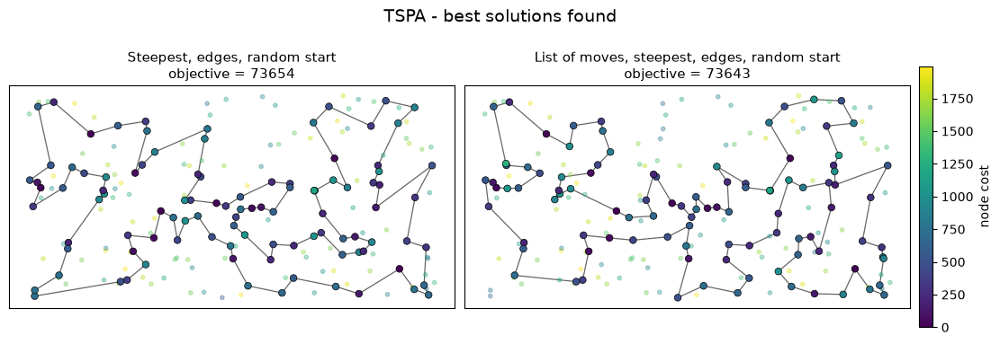
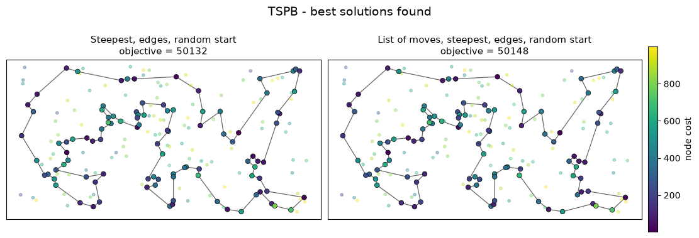

# Evolutionary Computation - Assignment 5 (list of improving moves in local search)

Authors:
1. Name: Tomasz Preś  Index number: 160305
2. Name: Marek Olejniczak  Index number: 160303

## Problem

We are given three columns of integers with a row for each node. The first two columns contain x
and y coordinates of the node positions in a plane. The third column contains node costs. The goal is
to select exactly 50% of the nodes (if the number of nodes is odd we round the number of nodes to
be selected up) and form a Hamiltonian cycle (closed path) through this set of nodes such that the
sum of the total length of the path plus the total cost of the selected nodes is minimized.

The distances between nodes are calculated as Euclidean distances rounded mathematically to
integer values. The distance matrix is calculated just after reading an instance and then only
the distance matrix (no nodes coordinates) is accessed by the optimization methods.

## Algorithms (pseudocode)

Neighborhood: inter-route node exchange + intra-route two-edges exchange, steepest, random start.

### Baseline: steepest local search

```
x = random solution
repeat:
    evaluate all moves of x
    if best delta < 0: apply best move
until no improving move
```

### Moves

```
node exchange (v, u, p, nx):   v in x between p and nx, u not in x
    delta = d(p,u) + d(u,nx) - d(p,v) - d(v,nx) + c(u) - c(v)

edges exchange (a -> an, b -> bn):   remove a -> an, b -> bn, add (a,b), (an,bn)
    delta = d(a,b) + d(an,bn) - d(a,an) - d(b,bn)
```

For a pair of edges the move is evaluated in two versions: (a -> an, b -> bn) and (a -> an, bn -> b).
Only one of them gives a single cycle in the current solution, the other one can become applicable
after a part of the cycle containing one of the edges is reversed.

### Steepest local search with the list of improving moves (LM)

```
x ← random solution
LM ← ∅                                        (sorted by delta, best first)
for each move m of x (edges exchange in both versions):
    if delta(m) < 0: insert m into LM

repeat
    found ← false
    for each m in LM, from the best:
        if m is node exchange (v, u, p, nx):
            if v ∈ x and u ∉ x and neighbours of v in x = {p, nx}:
                found ← true
            else:
                remove m from LM
        if m is edges exchange (a → an, b → bn):
            if edge (a, an) ∉ x or edge (b, bn) ∉ x:
                remove m from LM
            else if both edges in x have the same direction as in m, or both are reversed:
                found ← true
            else:
                skip m                        (stays in LM)
        if found:
            remove m from LM
            x ← m(x)
            evaluate new moves of x, insert those with delta < 0 into LM
            break
until not found
return x
```

New moves evaluated after applying m:

```
edges exchange, new edges e1, e2:
    e1, e2 x all other edges (both versions)
    end nodes of e1, e2 x all nodes not in x
node exchange, v replaced by u between p and nx:
    (p,u), (u,nx) x all other edges (both versions)
    p, u, nx x all nodes not in x
    all nodes in x x v
```

LM is a binary heap, skipped moves are put back after browsing.

Correctness test: for every applied move real change of objective = delta, and the final solutions are
local optima of the full neighborhood. Results equal to baseline in 183/200 (TSPA) and 173/200 (TSPB)
runs, the rest differ because of ties.

Each method run 200 times from the same random solutions as in assignments 3 and 4. C++ (g++ -O2).

## Results

Cells: average (min – max). Bold = best average and best minimum in the column, underlined = methods
from the current assignment.

### Objective function

Methods from assignments 1-4: values from assignments 3 and 4.

| Method | TSPA | TSPB |
|---|---|---|
| Random | 261332.1 (233090 – 292399) | 207232.3 (184861 – 226897) |
| NN (end only) | 87476.6 (84362 – 90075) | 59397.3 (56007 – 63166) |
| NN (any position) | 74306.5 (72328 – 77022) | 59476.2 (52915 – 66164) |
| Greedy cycle | 73728.7 (72590 – 75281) | 59710.4 (53016 – 63736) |
| 2-regret (NN any) | 121360.3 (110950 – 135771) | 73649.8 (68761 – 79756) |
| 2-regret (greedy cycle) | 120367.5 (110303 – 128089) | 72368.0 (67078 – 76382) |
| Weighted (NN any) | 75549.4 (72419 – 78504) | 55698.9 (50485 – 61406) |
| Weighted (greedy cycle) | 73348.7 (72011 – 75532) | 57892.5 (52731 – 63370) |
| Weighted (greedy cycle, 1:2) | 73191.4 (72049 – 75212) | 55667.6 (52099 – 62556) |
| Steepest, nodes, random start | 90301.3 (84408 – 96984) | 66169.3 (58136 – 73227) |
| Steepest, nodes, greedy start | 72861.6 (71955 – 75044) | 55116.7 (52096 – 62323) |
| Steepest, edges, greedy start | **72811.3** (**71925** – 74680) | 54861.7 (52096 – 62039) |
| Greedy, nodes, random start | 88132.5 (82514 – 96313) | 63778.0 (57427 – 70983) |
| Greedy, nodes, greedy start | 72861.5 (71955 – 75044) | 55114.2 (52096 – 62323) |
| Greedy, edges, random start | 76146.8 (73779 – 78842) | 52940.4 (**49873** – 56263) |
| Greedy, edges, greedy start | 72820.3 (71955 – 74680) | 54788.1 (52096 – 61860) |
| Candidates (5), steepest, edges, random start | 86638.6 (80796 – 92972) | 54002.9 (51295 – 56776) |
| Candidates (10), steepest, edges, random start | 80057.2 (75486 – 88182) | 52565.1 (50309 – 56225) |
| Candidates (15), steepest, edges, random start | 77511.3 (74305 – 82280) | 52600.3 (50386 – 54831) |
| Candidates (20), steepest, edges, random start | 76607.3 (73440 – 80446) | 52627.9 (50386 – 54972) |
| Steepest, edges, random start | 76237.3 (73654 – 79812) | 52575.6 (50132 – 55820) |
| <u>List of moves, steepest, edges, random start</u> | 76216.1 (73643 – 79812) | **52544.1** (50148 – 55820) |

### Running time [ms] per run

| Method | TSPA | TSPB |
|---|---|---|
| Steepest, edges, random start | 3.575 (2.858 – 9.584) | 3.347 (2.859 – 4.154) |
| <u>List of moves, steepest, edges, random start</u> | **1.746** (**1.422** – 2.164) | **1.703** (**1.405** – 1.954) |

### Running time [ms] per run, local search only (without creating the starting solution)

| Method | TSPA | TSPB |
|---|---|---|
| Steepest, edges, random start | 3.574 (2.857 – 9.583) | 3.345 (2.858 – 4.152) |
| <u>List of moves, steepest, edges, random start</u> | **1.745** (**1.421** – 2.163) | **1.701** (**1.404** – 1.952) |

### Number of evaluated moves per run

| Method | TSPA | TSPB |
|---|---|---|
| Steepest, edges, random start | 1978762 (1707750 – 2390850) | 1997399 (1707750 – 2227500) |
| <u>List of moves, steepest, edges, random start</u> | **123619** (**109252** – 145394) | **124556** (**109261** – 136750) |

## Best solutions

Color of a node = its cost (bigger, outlined dots are the selected nodes).

### TSPA



TSPA, Steepest, edges, random start: 73654

```
[53, 140, 41, 58, 84, 134, 72, 176, 151, 42, 89, 113, 106, 150, 174, 194, 8, 142, 85, 164, 186, 136, 178, 29, 55, 101, 1, 169, 3, 50, 93, 147, 47, 130, 159, 153, 78, 88, 107, 57, 182, 158, 192, 181, 135, 73, 45, 185, 102, 87, 28, 180, 141, 30, 187, 189, 2, 171, 104, 129, 69, 127, 97, 160, 83, 123, 100, 152, 108, 49, 168, 63, 149, 116, 60, 31, 48, 80, 91, 157, 71, 132, 76, 4, 112, 139, 51, 16, 156, 35, 67, 144, 52, 33, 9, 54, 131, 36, 177, 179]
```

TSPA, List of moves, steepest, edges, random start: 73643

```
[36, 131, 33, 143, 9, 54, 194, 8, 164, 186, 136, 163, 29, 101, 178, 59, 1, 169, 50, 147, 47, 130, 159, 146, 170, 153, 78, 88, 107, 64, 57, 182, 138, 151, 150, 106, 89, 93, 3, 85, 142, 174, 176, 134, 84, 58, 158, 192, 181, 114, 135, 73, 140, 45, 87, 141, 30, 187, 2, 171, 69, 127, 97, 168, 116, 149, 63, 11, 49, 152, 108, 60, 82, 31, 48, 80, 38, 91, 157, 71, 4, 76, 132, 100, 123, 160, 83, 90, 180, 28, 185, 35, 51, 16, 67, 144, 53, 179, 52, 177]
```

### TSPB



TSPB, Steepest, edges, random start: 50132

```
[46, 72, 120, 8, 133, 136, 172, 160, 69, 189, 183, 130, 191, 30, 176, 21, 38, 47, 140, 154, 26, 125, 177, 170, 115, 180, 6, 71, 40, 60, 45, 134, 175, 36, 197, 29, 132, 178, 65, 145, 28, 149, 116, 147, 121, 198, 96, 89, 57, 185, 76, 104, 162, 192, 54, 187, 70, 81, 94, 105, 61, 196, 114, 10, 90, 129, 127, 80, 52, 182, 153, 14, 110, 93, 9, 2, 20, 74, 17, 171, 99, 31, 67, 24, 34, 152, 181, 179, 87, 82, 85, 51, 167, 73, 59, 98, 151, 3, 184, 86]
```

TSPB, List of moves, steepest, edges, random start: 50148

```
[46, 72, 120, 8, 133, 136, 172, 160, 69, 189, 183, 130, 191, 30, 176, 21, 38, 47, 140, 154, 26, 125, 177, 170, 115, 180, 6, 71, 40, 60, 45, 134, 175, 36, 197, 29, 132, 178, 65, 145, 28, 149, 116, 147, 121, 198, 96, 89, 57, 185, 76, 104, 162, 192, 54, 187, 70, 81, 94, 105, 61, 196, 114, 10, 90, 129, 127, 80, 52, 182, 153, 74, 20, 14, 110, 93, 9, 2, 17, 171, 99, 31, 67, 24, 34, 152, 181, 179, 87, 82, 85, 51, 167, 73, 59, 98, 151, 3, 184, 86]
```


## Checker

Yes, the best solutions were checked with the solution checker (in C++ and independently in Python from
the coordinates), values are the same.

## Code

lm.cpp (C++, standard library only). Link: https://github.com/tomasz-pres/evolutionary-computing.git

## Conclusions

- LM is about 2x faster than the baseline (TSPA 3.57 -> 1.74 ms, TSPB 3.35 -> 1.70 ms), same quality
  (differences only because of ties)
- 16x fewer evaluated moves (~124k vs ~2M), but the time gain is smaller because of the heap
  operations and checking moves that are no longer valid
- candidate moves (assignment 4) were faster (0.63 ms) but worse on TSPA, LM does not lose quality
