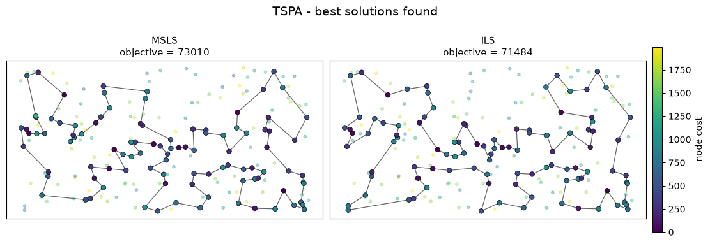
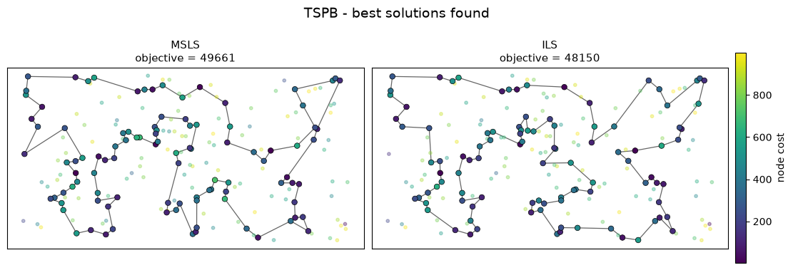

# Evolutionary Computation - Assignment 6 (MSLS and ILS)

Authors:
1. Name: Tomasz Preś  Index number: 160305
2. Name: Marek Olejniczak  Index number: 160303

## Problem

We are given three columns of integers with a row for each node. The first two columns contain x
and y coordinates of the node positions in a plane. The third column contains node costs. The goal is
to select exactly 50% of the nodes (if the number of nodes is odd we round the number of nodes to
be selected up) and form a Hamiltonian cycle (closed path) through this set of nodes such that the
sum of the total length of the path plus the total cost of the selected nodes is minimized.

The distances between nodes are calculated as Euclidean distances rounded mathematically to
integer values. The distance matrix is calculated just after reading an instance and then only
the distance matrix (no nodes coordinates) is accessed by the optimization methods.

## Algorithms (pseudocode)

Local search (LS) in both methods: steepest local search with the list of improving moves from
assignment 5 (inter-route node exchange + intra-route two-edges exchange).

### Multiple start local search (MSLS)

```
best ← none
repeat 400 times:
    x ← random solution
    x ← LS(x)
    if f(x) < f(best): best ← x
return best
```

### Iterated local search (ILS)

```
x ← random solution
x ← LS(x)
repeat until time limit (average time of MSLS on this instance):
    y ← perturb(x)
    y ← LS(y)
    if f(y) < f(x): x ← y
return x
```

### Perturbation

```
perturb(x):
    y ← copy of x
    # 1 double bridge
    choose random positions 0 < i < j < k < K
    cut y into 4 parts A = y[0..i-1], B = y[i..j-1], C = y[j..k-1], D = y[k..K-1]
    y ← A + C + B + D
    # 8 node replacements
    repeat 8 times:
        v ← random node in y
        u ← random node not in y
        replace v by u (u takes the position of v)
    return y
```

Double bridge changes 3 edges in a way that two-edges exchange cannot easily undo, node replacements
change the set of selected nodes. Strength was chosen in a short test (5 runs, different seed) of
0-2 double bridges and 0-16 replacements: 1 double bridge + 8 replacements was the best on average on
both instances, but the differences between 1-2 double bridges and 4-16 replacements were small.

Each method run 20 times on each instance. MSLS: 400 LS runs. ILS: stops after the average running
time of MSLS on the same instance. C++ (g++ -O2).

## Results

Cells: average (min – max). Bold = best average and best minimum in the column, underlined = methods
from the current assignment.

### Objective function

Best constructive heuristic and best local search versions from assignments 2, 3 and 5 (200 runs),
MSLS and ILS (20 runs).

| Method | TSPA | TSPB |
|---|---|---|
| Weighted (greedy cycle, 1:2) | 73191.4 (72049 – 75212) | 55667.6 (52099 – 62556) |
| Steepest, edges, greedy start | 72811.3 (71925 – 74680) | 54861.7 (52096 – 62039) |
| Greedy, edges, random start | 76146.8 (73779 – 78842) | 52940.4 (49873 – 56263) |
| Steepest, edges, random start | 76237.3 (73654 – 79812) | 52575.6 (50132 – 55820) |
| List of moves, steepest, edges, random start | 76216.1 (73643 – 79812) | 52544.1 (50148 – 55820) |
| <u>MSLS</u> | 73613.6 (73010 – 74057) | 50140.2 (49661 – 50433) |
| <u>ILS</u> | **71607.3** (**71484** – 71998) | **48255.4** (**48150** – 48557) |

### Running time [ms] per run

| Method | TSPA | TSPB |
|---|---|---|
| <u>MSLS</u> | **712.7** (**692.4** – 800.9) | **691.6** (**676.2** – 730.8) |
| <u>ILS</u> | 713.8 (712.7 – 734.1) | 691.7 (691.6 – 691.8) |

### Number of LS runs in ILS

| Method | TSPA | TSPB |
|---|---|---|
| <u>ILS</u> | **3823.8** (**3545** – 3921) | **3729.4** (**2890** – 3840) |

## Best solutions

Color of a node = its cost (bigger, outlined dots are the selected nodes).

### TSPA



TSPA, MSLS: 73010

```
[97, 127, 69, 171, 2, 189, 187, 30, 141, 87, 180, 28, 102, 185, 156, 35, 67, 144, 53, 140, 45, 73, 135, 25, 114, 181, 192, 158, 58, 84, 134, 72, 176, 150, 106, 113, 89, 42, 151, 182, 57, 64, 107, 88, 78, 193, 153, 170, 146, 159, 130, 93, 50, 3, 1, 47, 147, 101, 29, 178, 164, 142, 85, 174, 8, 54, 9, 33, 131, 36, 177, 179, 52, 16, 51, 139, 112, 157, 71, 4, 76, 132, 90, 83, 160, 123, 100, 152, 108, 80, 48, 31, 82, 60, 49, 11, 63, 149, 116, 168]
```

TSPA, ILS: 71484

```
[72, 134, 84, 58, 158, 192, 181, 114, 135, 73, 45, 87, 141, 30, 187, 189, 2, 171, 104, 129, 69, 127, 97, 160, 83, 123, 100, 152, 108, 49, 168, 63, 149, 116, 60, 31, 48, 80, 91, 157, 71, 4, 76, 132, 180, 28, 102, 185, 35, 156, 51, 16, 67, 144, 140, 53, 179, 52, 177, 36, 131, 33, 9, 54, 8, 174, 85, 93, 50, 3, 169, 1, 164, 186, 136, 184, 178, 29, 101, 147, 47, 130, 159, 146, 170, 153, 193, 78, 88, 107, 64, 57, 182, 151, 42, 89, 113, 106, 150, 176]
```

### TSPB



TSPB, MSLS: 49661

```
[71, 40, 60, 45, 134, 175, 62, 36, 197, 132, 29, 6, 180, 115, 170, 177, 125, 26, 158, 65, 145, 28, 149, 13, 146, 37, 116, 147, 42, 121, 198, 96, 48, 156, 89, 57, 185, 76, 162, 192, 54, 78, 196, 187, 70, 81, 94, 105, 114, 10, 127, 80, 129, 90, 153, 20, 14, 2, 74, 171, 99, 31, 67, 66, 11, 24, 34, 152, 181, 179, 87, 82, 167, 51, 85, 59, 151, 122, 184, 3, 86, 46, 72, 120, 133, 136, 172, 160, 69, 168, 189, 183, 30, 21, 38, 47, 140, 154, 97, 155]
```

TSPB, ILS: 48150

```
[181, 167, 73, 59, 85, 51, 82, 87, 179, 88, 99, 171, 17, 74, 20, 2, 14, 153, 90, 129, 127, 80, 192, 162, 54, 78, 10, 114, 196, 61, 105, 94, 81, 187, 70, 190, 104, 76, 185, 57, 89, 48, 96, 198, 121, 42, 147, 116, 37, 146, 13, 149, 28, 145, 158, 177, 125, 170, 115, 180, 6, 29, 132, 197, 36, 175, 134, 45, 157, 60, 40, 71, 155, 97, 154, 140, 47, 38, 21, 30, 183, 69, 160, 172, 136, 133, 120, 8, 117, 72, 46, 184, 3, 151, 27, 66, 67, 24, 34, 152]
```


## Checker

Yes, the best solutions were checked with the solution checker (in C++ and independently in Python from
the coordinates), values are the same.

## Code

ils.cpp (C++, standard library only). Link: https://github.com/tomasz-pres/evolutionary-computing.git

## Conclusions

- ILS is clearly better than MSLS in the same time: TSPA 71607 vs 73614 (-2.7%), TSPB 48255 vs 50140
  (-3.8%), the worst ILS run is better than the best MSLS run on both instances
- ILS does ~3800 LS runs in the time of 400 in MSLS, because LS after a small perturbation starts from
  an almost good solution and needs only a few moves
- MSLS is better than a single LS (best of 400 random starts), but every LS starts from scratch, so it
  can not get much better with more iterations
- ILS is the best method so far, better than all constructive heuristics and single LS versions
