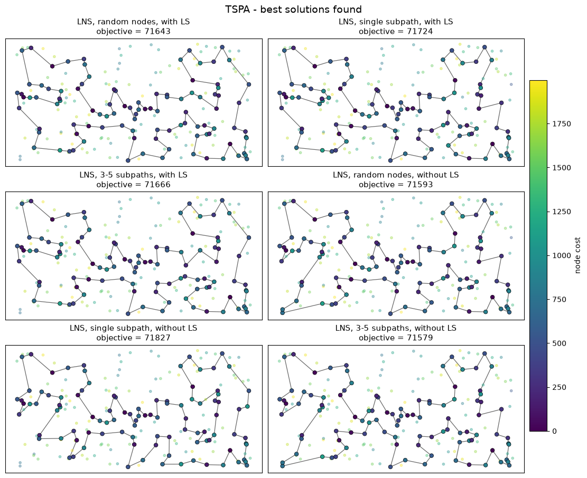
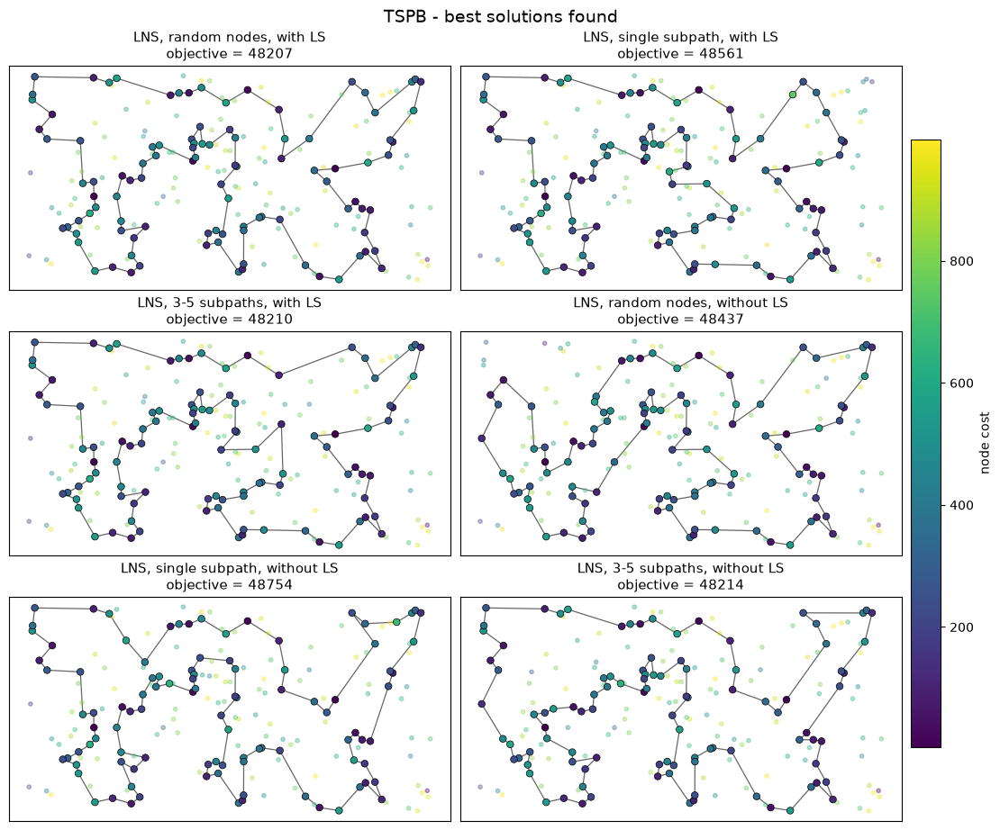

# Evolutionary Computation - Assignment 7 (large neighborhood search)

Authors:
1. Name: Tomasz Preś  Index number: 160305
2. Name: Marek Olejniczak  Index number: 160303

## Problem

We are given three columns of integers with a row for each node. The first two columns contain x
and y coordinates of the node positions in a plane. The third column contains node costs. The goal is
to select exactly 50% of the nodes (if the number of nodes is odd we round the number of nodes to
be selected up) and form a Hamiltonian cycle (closed path) through this set of nodes such that the
sum of the total length of the path plus the total cost of the selected nodes is minimized.

The distances between nodes are calculated as Euclidean distances rounded mathematically to
integer values. The distance matrix is calculated just after reading an instance and then only
the distance matrix (no nodes coordinates) is accessed by the optimization methods.

## Algorithms (pseudocode)

Local search (LS): steepest local search with the list of improving moves from assignment 5
(inter-route node exchange + intra-route two-edges exchange).

### Large neighborhood search (LNS)

```
x ← random solution
x ← LS(x)
repeat until time limit (average time of MSLS on this instance):
    y ← destroy(x)
    y ← repair(y)
    y ← LS(y)                                 (only in the version with LS)
    if f(y) < f(x): x ← y
return x
```

### Destroy

All versions remove m = 30% of the nodes of x (m = 30 for K = 100). The remaining nodes keep their
order in the cycle.

```
destroy_random_nodes(x):
    repeat m times:
        remove a random node from x
    return x

destroy_single_subpath(x):
    s ← random position
    remove x[s], x[s+1], ..., x[s+m-1]        (positions mod K)
    return x

destroy_3_5_subpaths(x):
    p ← random from {3, 4, 5}
    r1..rp ← random split of m into p parts ≥ 1          (lengths of removed subpaths)
    k1..kp ← random split of K - m into p parts ≥ 1      (lengths of kept parts between them)
    s ← random position
    from s along the cycle: remove r1 nodes, keep k1, remove r2, keep k2, ..., remove rp, keep kp
    return x
```

The kept parts are at least 1 node long, so the removed subpaths never join into a longer one.

### Repair

Weighted 2-regret greedy cycle (the best constructive heuristic from assignment 2, weights 1:2),
started from the partial cycle after destroy:

```
repair(y):
    while |y| < K:
        for each node u not in y:
            best(u), second(u) ← two smallest  d(a,u) + d(u,b) - d(a,b)  over edges (a,b) of y
            score(u) ← (second(u) - best(u)) - 2 * (best(u) + c(u))
        u ← node with the largest score (ties: smaller best(u) + c(u))
        insert u into its best edge
    return y
```

For every free node the two best edges are remembered, after an insertion into edge (a, b) only the two
new edges are checked (full recomputation only for nodes whose remembered edge was (a, b)).

Each version run 20 times on each instance. Time limit = average running time of MSLS from assignment 6
(TSPA 712.7 ms, TSPB 691.6 ms). C++ (g++ -O2).

## Results

Cells: average (min – max). Bold = best average and best minimum in the column, underlined = methods
from the current assignment.

### Objective function

Best constructive heuristic and best local search versions from assignments 2, 3 and 5 (200 runs),
MSLS and ILS from assignment 6 (20 runs), LNS (20 runs).

| Method | TSPA | TSPB |
|---|---|---|
| Weighted (greedy cycle, 1:2) | 73191.4 (72049 – 75212) | 55667.6 (52099 – 62556) |
| Steepest, edges, greedy start | 72811.3 (71925 – 74680) | 54861.7 (52096 – 62039) |
| Greedy, edges, random start | 76146.8 (73779 – 78842) | 52940.4 (49873 – 56263) |
| Steepest, edges, random start | 76237.3 (73654 – 79812) | 52575.6 (50132 – 55820) |
| List of moves, steepest, edges, random start | 76216.1 (73643 – 79812) | 52544.1 (50148 – 55820) |
| MSLS | 73613.6 (73010 – 74057) | 50140.2 (49661 – 50433) |
| ILS | **71607.3** (**71484** – 71998) | **48255.4** (**48150** – 48557) |
| <u>LNS, random nodes, with LS</u> | 72029.2 (71643 – 72928) | 48743.9 (48207 – 50638) |
| <u>LNS, single subpath, with LS</u> | 71869.3 (71724 – 72377) | 49243.1 (48561 – 51193) |
| <u>LNS, 3-5 subpaths, with LS</u> | 71693.1 (71666 – 71724) | 48859.8 (48210 – 51178) |
| <u>LNS, random nodes, without LS</u> | 72147.8 (71593 – 73347) | 49108.2 (48437 – 50489) |
| <u>LNS, single subpath, without LS</u> | 72048.3 (71827 – 72919) | 49636.5 (48754 – 50311) |
| <u>LNS, 3-5 subpaths, without LS</u> | 71704.8 (71579 – 71728) | 48685.1 (48214 – 49916) |

### Running time [ms] per run

| Method | TSPA | TSPB |
|---|---|---|
| <u>LNS, random nodes, with LS</u> | 712.8 (712.7 – 712.9) | 691.7 (691.6 – 691.7) |
| <u>LNS, single subpath, with LS</u> | 712.8 (712.7 – 712.9) | 691.7 (**691.6** – 691.8) |
| <u>LNS, 3-5 subpaths, with LS</u> | 712.8 (712.7 – 712.9) | 691.7 (691.6 – 691.8) |
| <u>LNS, random nodes, without LS</u> | **712.7** (**712.7** – 712.8) | **691.6** (691.6 – 691.7) |
| <u>LNS, single subpath, without LS</u> | 712.8 (712.7 – 712.9) | 691.7 (691.6 – 691.8) |
| <u>LNS, 3-5 subpaths, without LS</u> | 712.8 (712.7 – 712.8) | 691.7 (691.6 – 691.7) |

### Number of iterations of the main loop

| Method | TSPA | TSPB |
|---|---|---|
| <u>LNS, random nodes, with LS</u> | 3934.2 (3741 – 4064) | 3782.3 (3299 – 3927) |
| <u>LNS, single subpath, with LS</u> | 2605.9 (2442 – 2661) | 2409.1 (2259 – 2548) |
| <u>LNS, 3-5 subpaths, with LS</u> | 3086.4 (2970 – 3148) | 2937.3 (2737 – 3059) |
| <u>LNS, random nodes, without LS</u> | 5973.4 (5647 – 6184) | 5710.9 (5005 – 6067) |
| <u>LNS, single subpath, without LS</u> | 3420.6 (3253 – 3523) | 3196.1 (3070 – 3349) |
| <u>LNS, 3-5 subpaths, without LS</u> | 4196.4 (4005 – 4268) | 4029.7 (3761 – 4225) |

## Best solutions

Color of a node = its cost (bigger, outlined dots are the selected nodes).

### TSPA



TSPA, LNS, random nodes, with LS: 71643

```
[180, 28, 102, 185, 35, 51, 16, 67, 144, 140, 53, 179, 52, 177, 36, 131, 33, 9, 54, 8, 142, 85, 93, 50, 3, 169, 1, 164, 186, 136, 184, 178, 29, 101, 147, 47, 130, 159, 146, 170, 153, 193, 78, 88, 107, 64, 57, 182, 151, 42, 89, 113, 106, 150, 174, 176, 72, 134, 84, 58, 158, 192, 181, 114, 135, 73, 45, 87, 141, 30, 187, 189, 2, 171, 92, 69, 127, 97, 168, 116, 149, 63, 11, 49, 160, 83, 123, 100, 152, 108, 60, 31, 48, 80, 91, 157, 71, 4, 76, 132]
```

TSPA, LNS, single subpath, with LS: 71724

```
[29, 178, 184, 136, 186, 164, 142, 8, 54, 9, 33, 131, 36, 177, 52, 179, 53, 140, 144, 67, 16, 51, 35, 185, 102, 28, 180, 132, 76, 4, 71, 157, 91, 80, 48, 31, 60, 108, 152, 100, 90, 123, 83, 160, 49, 11, 63, 149, 116, 168, 97, 127, 69, 92, 171, 2, 189, 187, 30, 141, 87, 45, 73, 135, 114, 181, 192, 158, 58, 84, 134, 72, 176, 174, 150, 106, 113, 89, 42, 151, 138, 182, 57, 64, 107, 88, 78, 193, 153, 170, 146, 159, 130, 47, 93, 50, 3, 169, 1, 101]
```

TSPA, LNS, 3-5 subpaths, with LS: 71666

```
[69, 92, 171, 2, 189, 187, 30, 141, 87, 45, 73, 135, 114, 181, 192, 158, 58, 84, 134, 72, 176, 150, 106, 113, 89, 42, 151, 138, 182, 57, 64, 107, 88, 78, 193, 153, 170, 146, 159, 130, 47, 147, 101, 29, 178, 184, 136, 186, 164, 1, 169, 3, 50, 93, 85, 174, 8, 54, 9, 33, 131, 36, 177, 52, 179, 53, 140, 144, 67, 16, 51, 35, 185, 102, 28, 180, 132, 76, 4, 71, 157, 91, 80, 48, 31, 60, 108, 152, 100, 123, 83, 160, 49, 11, 63, 149, 116, 168, 97, 127]
```

TSPA, LNS, random nodes, without LS: 71593

```
[142, 8, 54, 9, 33, 131, 36, 177, 52, 179, 53, 140, 144, 67, 16, 51, 35, 185, 102, 28, 180, 132, 76, 4, 71, 157, 91, 80, 48, 31, 60, 116, 149, 63, 168, 11, 49, 108, 152, 100, 123, 83, 160, 97, 127, 69, 129, 104, 92, 171, 2, 189, 187, 30, 141, 87, 45, 73, 135, 114, 181, 192, 158, 58, 84, 134, 72, 176, 174, 150, 106, 113, 89, 42, 151, 182, 57, 64, 107, 88, 78, 193, 153, 170, 146, 159, 130, 47, 93, 50, 3, 169, 1, 101, 29, 178, 184, 136, 186, 164]
```

TSPA, LNS, single subpath, without LS: 71827

```
[150, 106, 151, 42, 89, 113, 93, 50, 3, 169, 1, 85, 142, 164, 186, 136, 184, 178, 29, 101, 147, 37, 47, 130, 159, 146, 170, 153, 193, 78, 88, 107, 64, 57, 182, 111, 192, 158, 134, 84, 58, 181, 114, 135, 73, 45, 87, 141, 189, 2, 171, 187, 30, 161, 127, 97, 160, 83, 123, 100, 152, 108, 49, 11, 168, 63, 149, 116, 60, 31, 48, 80, 91, 157, 71, 4, 76, 132, 180, 28, 102, 185, 35, 51, 16, 67, 144, 140, 53, 179, 52, 177, 36, 131, 33, 9, 54, 8, 174, 176]
```

TSPA, LNS, 3-5 subpaths, without LS: 71579

```
[54, 8, 142, 164, 186, 136, 184, 178, 29, 101, 1, 169, 3, 50, 93, 47, 130, 159, 146, 170, 153, 193, 78, 88, 107, 64, 57, 182, 151, 42, 89, 113, 106, 150, 174, 176, 72, 134, 84, 58, 158, 192, 181, 114, 135, 73, 45, 185, 102, 87, 141, 30, 187, 189, 2, 171, 92, 104, 129, 69, 127, 97, 160, 83, 123, 100, 152, 108, 49, 168, 63, 149, 116, 60, 31, 48, 80, 91, 157, 71, 4, 76, 132, 180, 28, 156, 35, 51, 16, 67, 144, 140, 53, 179, 52, 177, 36, 131, 33, 9]
```

### TSPB



TSPB, LNS, random nodes, with LS: 48207

```
[162, 192, 80, 127, 129, 90, 153, 14, 2, 20, 74, 17, 171, 99, 67, 24, 34, 152, 181, 179, 87, 82, 51, 85, 59, 73, 167, 98, 151, 3, 184, 46, 72, 117, 8, 120, 133, 136, 172, 160, 69, 183, 30, 21, 38, 47, 140, 154, 97, 155, 71, 40, 60, 157, 45, 134, 175, 62, 36, 197, 132, 29, 6, 180, 115, 170, 125, 177, 158, 145, 28, 149, 13, 146, 37, 116, 147, 42, 121, 198, 96, 48, 156, 89, 57, 185, 76, 104, 190, 70, 187, 81, 94, 105, 61, 196, 114, 10, 78, 54]
```

TSPB, LNS, single subpath, with LS: 48561

```
[87, 179, 88, 99, 171, 17, 74, 20, 2, 14, 153, 90, 129, 127, 80, 192, 162, 54, 78, 10, 114, 196, 187, 70, 190, 194, 104, 76, 185, 57, 89, 156, 48, 96, 198, 121, 42, 147, 116, 37, 146, 13, 149, 28, 145, 158, 177, 125, 170, 115, 180, 6, 29, 132, 197, 36, 62, 175, 134, 45, 157, 60, 40, 71, 155, 97, 154, 140, 47, 38, 21, 30, 183, 69, 160, 172, 136, 133, 120, 8, 117, 72, 46, 184, 3, 122, 151, 27, 66, 67, 24, 34, 152, 181, 167, 73, 59, 85, 51, 82]
```

TSPB, LNS, 3-5 subpaths, with LS: 48210

```
[155, 71, 40, 60, 157, 45, 134, 175, 62, 36, 197, 132, 29, 6, 180, 115, 170, 125, 177, 158, 145, 28, 149, 13, 146, 37, 116, 147, 42, 121, 198, 96, 48, 156, 89, 57, 190, 70, 187, 81, 94, 105, 61, 196, 114, 10, 78, 54, 162, 192, 80, 127, 129, 90, 153, 14, 2, 20, 74, 17, 171, 99, 88, 179, 87, 82, 51, 85, 59, 73, 167, 181, 152, 34, 24, 67, 66, 76, 27, 151, 3, 184, 46, 72, 117, 8, 120, 133, 136, 172, 160, 69, 183, 30, 21, 38, 47, 140, 154, 97]
```

TSPB, LNS, random nodes, without LS: 48437

```
[87, 82, 51, 85, 59, 73, 167, 181, 152, 34, 24, 67, 66, 27, 151, 3, 184, 46, 72, 117, 8, 120, 133, 136, 172, 160, 69, 64, 40, 155, 71, 60, 157, 45, 134, 175, 62, 36, 197, 6, 29, 132, 103, 178, 65, 145, 28, 149, 158, 177, 125, 170, 115, 97, 154, 140, 47, 38, 21, 183, 30, 191, 130, 121, 198, 96, 48, 156, 89, 57, 185, 76, 104, 190, 70, 81, 94, 105, 61, 196, 114, 10, 78, 54, 162, 192, 80, 127, 129, 90, 153, 14, 2, 20, 74, 17, 171, 99, 88, 179]
```

TSPB, LNS, single subpath, without LS: 48754

```
[6, 180, 115, 170, 125, 177, 158, 145, 28, 149, 13, 146, 37, 116, 147, 50, 130, 121, 198, 96, 48, 156, 89, 57, 185, 76, 162, 192, 54, 187, 190, 70, 169, 81, 94, 105, 61, 196, 114, 10, 90, 129, 127, 80, 182, 153, 14, 2, 20, 74, 17, 171, 99, 67, 24, 34, 152, 181, 179, 87, 82, 51, 85, 59, 73, 167, 98, 151, 3, 184, 46, 72, 120, 133, 136, 172, 160, 69, 189, 21, 183, 30, 38, 47, 140, 154, 97, 155, 40, 60, 71, 157, 45, 134, 175, 62, 36, 197, 132, 29]
```

TSPB, LNS, 3-5 subpaths, without LS: 48214

```
[179, 181, 152, 34, 24, 67, 99, 171, 17, 74, 20, 2, 14, 153, 90, 129, 80, 127, 10, 114, 196, 61, 105, 94, 81, 190, 70, 187, 54, 192, 162, 76, 185, 57, 89, 156, 48, 96, 198, 121, 42, 147, 116, 37, 146, 13, 149, 28, 145, 65, 178, 103, 132, 29, 6, 197, 36, 62, 175, 134, 45, 157, 60, 40, 71, 155, 115, 170, 177, 125, 26, 154, 140, 47, 38, 21, 30, 183, 189, 69, 160, 172, 136, 133, 120, 8, 117, 72, 46, 184, 3, 151, 98, 167, 73, 59, 85, 51, 82, 87]
```


## Checker

Yes, the best solutions were checked with the solution checker (in C++ and independently in Python from
the coordinates), values are the same.

## Code

lns.cpp (C++, standard library only). Link: https://github.com/tomasz-pres/evolutionary-computing.git

## Conclusions

- all LNS versions are much better than MSLS in the same time (TSPA 71693-72148 vs 73614, TSPB
  48685-49637 vs 50140)
- LNS is a bit worse than ILS: the best versions TSPA 71693 vs 71607, TSPB 48685 vs 48255
- 3-5 subpaths is the best destroy operator on both instances, the worst is random nodes on TSPA
  and single subpath on TSPB
- LS after repair helps only a little or not at all (TSPA 3-5 subpaths 71693 vs 71705, TSPB 3-5
  subpaths 48860 vs 48685). The repair heuristic already gives a good solution, so LS fixes little,
  and without LS there are 1.3-1.5x more iterations
- some runs get stuck (TSPB max up to 51193), the repair is deterministic, so after the same
  destroy it builds the same solution again
